# HW04-AI — Automation Testing

## Trang bìa & Thông tin chung

| Thông tin | Nội dung |
| --- | --- |
| Họ tên | Lê Nguyễn Quốc Thái |
| MSSV | 23120352 |
| Môn học | Software Testing — Kiểm thử phần mềm |
| Mã bài tập | HW04-AI |
| Ngày nộp | Chưa nộp; ngày cập nhật báo cáo: 16/11/2026 |
| GitHub repository | [quocthaiLN/HW04-SoftwareTesting](https://github.com/quocthaiLN/HW04-SoftwareTesting); đã xác minh Public qua UI ngày 16/11/2026; đã đồng bộ bản chốt; Git log kèm lịch sử thật (REQ-16) |
| YouTube unlisted | [Video demo](https://youtu.be/-32746b5iEI?si=RqwYGPSNndiy2B_h) (sinh viên xác nhận hoàn tất đủ tiêu chí video ngày 16/11/2026) |
| Playwright reports | 9 HTML reports tại mục 5; [execution matrix](artifacts/execution-matrix.json) |

**AI declaration:** “I use AI tools for the following tasks: test automation planning, script generation and refactoring, execution analysis, bug documentation, and report drafting.” Công cụ: OpenAI Codex. Xem **Appendix A — AI Audit Report** ở cuối báo cáo; sinh viên chịu trách nhiệm review nội dung.

## 1. Tổng quan (Executive Summary)

Mục tiêu: tự động hóa kiểm thử UI cho EShop theo chiến lược AI-First, dữ liệu tách riêng, assertions rõ ràng và thực thi trên ba browser engines. SUT là EShop web/admin; backend được sao chép nguyên trạng vào runtime SQLite cô lập. FR-09 chạy UI giỏ hàng → checkout → áp coupon với backend thật, dừng trước xác nhận thanh toán.

| Chỉ số | Giá trị |
| --- | ---: |
| Số feature | 3 |
| Test case tự động hóa | 68 (14 / 19 / 35) |
| Test case thực thi phân biệt | 68 |
| Case pass / fail trên cả ma trận | 46 pass cả 3 engines / 22 fail cả 3 engines |
| Lượt thực thi case × browser | 204 |
| Lượt pass / fail / skip | 138 / 66 / 0 |
| Browser run | 9 (3 features × 3 engines) |
| Bug phát hiện | 12 nhóm defect |
| Commit chạm file .spec.js | 11 |

Evidence hiện hành gồm FR-02/FR-17 từ Session004 (93 pass/54 fail) và FR-09 thật từ Session006 (45 pass/12 fail). Tổng 204 lượt, 138 pass/66 fail/0 skip là tổng hợp **hai phiên chạy riêng**, không phải một lượt chạy lại toàn suite. [Execution matrix](artifacts/execution-matrix.json) lưu nguồn của từng run. 66 lượt fail tương ứng 22 case IDs trên ba engines, được gộp thành 12 nhóm defect.

## 2. Lựa chọn Feature

Sinh viên xác nhận Session001: ba features tương ứng HW02 và không trùng thành viên nhóm; không áp dụng trường hợp chưa có HW02.

| Pool | Feature | Lý do chọn | Phạm vi |
| --- | --- | --- | --- |
| A | FR-02 Login/lockout | Có state counter, JWT và biên thời gian | Login, input validation, khóa/mở khóa, reset, mask/heading |
| B | FR-09 Apply coupon | Có quyết định nghiệp vụ, payload và biên tiền | UI login → thêm hàng → cart → checkout → áp coupon; backend thật; không xác nhận tạo đơn |
| C | FR-17 Coupon management | Kết hợp CRUD, validation và persistence | Create/Read/Delete, dữ liệu biên, quyền UI; không Update vì SUT không hỗ trợ |

Phạm vi trong mục này và [test-cases.json](test-cases.json) chứa preconditions, steps, expected và traceability đầy đủ.

## 3. Môi trường & Kiến trúc Automation

| Thành phần | Sử dụng |
| --- | --- |
| Runner / ngôn ngữ | Playwright Test 1.65.0 / JavaScript CommonJS |
| CLI | @playwright/cli 0.1.24 |
| Runtime | Node.js v24.21.0; Linux; locale vi-VN; timezone Asia/Ho_Chi_Minh |
| Browsers (môi trường đã ghi nhận) | Chromium 158.0.8127.18; Firefox 159.0; WebKit 27.2 |
| Reporter | Playwright HTML + JSON + list |
| AI | OpenAI Codex; không suy đoán model version chưa được ghi nhận |
| Services | API :3000; web :5173; admin :5174; SQLite runtime cô lập |

Các browser versions nêu trên là môi trường được ghi nhận ở phiên chuẩn bị; preflight cũ đã xóa khi cleanup. Không coi đó là phép đo versions mới của Session004.

```text
submission/
├── tests/
│   ├── fr02-login.spec.js
│   ├── fr09-apply-coupon.spec.js
│   ├── fr17-coupons.spec.js
│   ├── pages/       # LoginPage, HomePage, CartPage, CheckoutPage, CouponsPage
│   ├── fixtures/    # real-sut và coupon-real
│   └── helpers/     # đọc JSON, resolve templates, format
├── data/            # shared.json, fr02.json, fr09.json, fr17.json
├── scripts/         # start-sut, validate, run-matrix, verify-reports
├── skills/.agents/skills/  # CLI / Core / POM / QA
├── artifacts/
│   ├── session004-refactor/  # matrix, summary, report-verification
│   ├── session004-refactor-<feature>-<browser>/
│   │   ├── html/            # reports thực tế (không có reports/ ở root)
│   │   └── results.json
│   └── evidence/            # ảnh bug và bằng chứng Issues
└── playwright.config.js
```

Luồng: JSON → validator → fixtures setup → thao tác UI/POM → assertions → runner HTML/JSON/trace → run-matrix tổng hợp → phân loại defect. POM chỉ thao tác UI; fixtures quản lý account/coupon/database cleanup. Mỗi test cô lập; workers=1, retries=0, chạy 9 tổ hợp tuần tự. Không sửa SUT hoặc expected để xanh test.

### Cấu hình multi-browser và attribution


```javascript
const startedAt = new Date().toISOString();
const artifactDir = path.resolve(__dirname, 'artifacts', runId);
module.exports = defineConfig({
  testDir: './tests', testMatch: '**/*.spec.js', fullyParallel: false,
  workers: 1, retries: 0, forbidOnly: true, timeout: 60000,
  expect: { timeout: 3000 },
  metadata: { 'Run by': '23120352', attribution: 'Run by: 23120352', timestamp: startedAt, runId, coverage: 'FR-02/09/17 real isolated backend; FR09 UI cart to coupon, no payment confirmation' },
  outputDir: path.join(artifactDir, 'test-results'),
  reporter: [['list'], ['html', { outputFolder: path.join(artifactDir, 'html'), open: 'never', title: `Run by: 23120352 | ${startedAt}` }], ['json', { outputFile: path.join(artifactDir, 'results.json') }]],
  use: { baseURL: process.env.WEB_URL || 'http://localhost:5173', headless: process.env.PW_HEADLESS === 'true', locale: 'vi-VN', timezoneId: 'Asia/Ho_Chi_Minh', serviceWorkers: 'block', trace: 'retain-on-failure', screenshot: 'only-on-failure', actionTimeout: 8000 },
  projects: [
    { name: 'chromium', use: { ...devices['Desktop Chrome'] } },
```

`projects` khai báo chromium/Firefox/WebKit với Desktop Chrome/Firefox/Safari; WebKit có thể dùng launcher local qua WEBKIT_EXECUTABLE_PATH. `startedAt = new Date().toISOString()` đưa vào title và metadata tại runtime; không sửa tay HTML. Cả 9 HTML reports giữ lại (6 Session004, 3 Session006) đã được mở trực tiếp và xác minh Run by + ISO + project tại lượt rà soát cuối: [verification](artifacts/evidence/final-report-verification.json). Không chạy lại SUT.

### Data-driven và assertions

Toàn bộ input, setup, seed, expected và business timing nằm trong JSON ngoài. Giá trị động được resolve từ template/ngày offset; thiếu field phải báo lỗi, không fallback hardcode. Test chỉ lặp các records cùng hành vi. FR-09 kiểm tra response backend thật với oracle nghiệp vụ ngoài JSON.


Inventory của code đã triển khai, không phải kế hoạch. Các vị trí theo tên scenario/method để tra bằng rg; script references nằm trong tests/.

| Pattern | Case thực sự dùng | Script / method | Oracle ngoài code |
| --- | --- | --- | --- |
| Text, exact | FR-02-TC02/03 lỗi chung; FR-09 success/error amounts; FR-17 Create/Read fields | fr02-login.spec.js wrong/missing; pages/coupons.js assertRow | shared.expected.error; fr09.expected và shared.ui display prefixes/suffixes; fr17 records + shared defaults/typeLabels |
| Attribute/value | FR-02-TC06 email; TC13 password; FR-17-TC15 uppercase/TC16 reset | fr02-login.spec.js format/mask; fr17-coupons.spec.js uppercase/reset | shared.expected.emailType/passwordType; shared.maskPassword; shared.resetExpected |
| URL | FR-02-TC01/07/10/11/12 login thành công, TC14 login page | fr02-login.spec.js success/lockout/heading | Route là contract kỹ thuật của app; test inputs trong JSON |
| State/count | FR-09-TC13/14 disabled/no request; FR-17-TC04 Delete, TC36/37 access | fr09-apply-coupon.spec.js empty; fr17-coupons.spec.js delete/permissions | fr09.expected.applyCount/checkoutCount; fr17.expected.rowCount; shared.expected.zero |
| Polling DB state | FR-02-TC02 mỗi lần sai +1, TC11 reset | fr02-login.spec.js wrong/reset | shared.expected.one/zero, shared.null |
| Network/payload equality | FR-09-TC15/16 normalization, FR-02-TC12 Bearer JWT, FR-17-TC05 duplicate status | fr09-apply-coupon.spec.js; fr02-login.spec.js jwt; fr17-coupons.spec.js duplicate | JSON expected.code/total/user_id; login result token; shared.duplicateStatuses |
| Time/date policy | FR-02-TC08/09 duration, TC10 unlock; FR-17 expiry | fr02-login.spec.js lock/lock-deadline/unlock; pages/coupons.js assertRow | shared.expected.lockSeconds/unlockWaitMs; JSON expiry offsets/past date |

Giá trị kỳ vọng đọc từ JSON, không lấy từ UI vừa đọc để làm chính oracle cho UI. So sánh JWT với token cấp sau login chỉ là kiểm tra propagation, không chứng minh JWT cryptographic validity. FR-09 hiện so response backend thật với expected trong JSON; các giá trị ID/token động lấy từ fixture/login thật để kiểm tra request propagation.

Không đếm nhiều lần cùng matcher là nhiều patterns. Soft assertions chỉ dùng để thu thêm bằng chứng liên quan trong cùng case; mọi soft failure vẫn làm case failed.


### Cách chạy lại

```bash
cd submission
npm ci
npx playwright install chromium firefox webkit
npm run validate
# Terminal riêng:
npm run sut
# Terminal chạy tests, SUT đã sẵn sàng:
PW_BATCH_ID=my-new-batch npm run matrix
# Hoặc một feature/browser:
PW_RUN_ID=my-login-run npx playwright test tests/fr02-login.spec.js --project=chromium
```

SUT nguồn phải nằm tại `../eshop-sut/` so với thư mục submission; cài dependencies cho backend/frontend-web/frontend-admin và chạy `npm ci` trong submission. Cài browsers bằng `npx playwright install`; nếu thiếu thư viện hệ thống, dùng `npx playwright install-deps webkit`. Launcher dùng ports API 3000, web 5173, admin 5174 và DB sao chép cô lập tại `/tmp/hw04-sut-session003`; không xóa DB nguồn. Nếu đổi `SUT_RUNTIME_DIR`, launcher và tests phải dùng cùng giá trị. Dừng launcher bằng Ctrl+C trong terminal đã khởi động để dừng đúng các process con; không dùng killall. Mỗi lần khởi động backend sẽ reset DB runtime. Dùng batch ID mới để bảo tồn evidence. TC10 đợi 31 giây thật cho policy mở khóa; đây là business deadline ngoài JSON, không phải sleep chờ UI tùy ý.

## 4. Quy trình AI-First

Áp dụng bộ skill Playwright theo vai trò: CLI quan sát UI → QA đối chiếu cases đã duyệt → Core viết assertions/fixtures/config → POM gom thao tác UI lặp lại → chạy matrix → QA phân loại fail/review → sinh viên chốt. Chi tiết từng thành phần ở mục 9.

1. Sinh viên xác nhận scope, thiết kế testcase và bổ sung BVA trước automation; AI không tự chốt policy còn mơ hồ.
2. CLI snapshot trước thao tác, dùng named session; không đưa snapshot refs vào spec lâu dài.
3. AI tạo theo từng nhóm feature/case, dữ liệu JSON ngoài; không yêu cầu một prompt sinh toàn bộ suite.
4. Core/POM chuẩn hóa fixtures, web-first assertions, locators và cleanup; validator đối chiếu stable case IDs.
5. Chạy ba engines, giữ fail thật; đọc report/trace/DB để phân biệt defect, script issue và environment issue.
6. Sinh viên review; AI sửa Conditional Test Logic, chạy batch Session004; sinh viên chấp nhận refactor và review còn lại. Lịch sử tương tác: Appendix A.

Lịch sử ban đầu có ngoại lệ mock own API cho FR-09 theo quyết định sinh viên; sau review, toàn bộ 19 cases đã thay bằng luồng UI/backend thật. Các kết quả mock chỉ còn trong audit và lịch sử testcase. Suite dùng retries=0 và trace retain-on-failure để giữ lỗi ngay lần đầu; không sao chép mặc định retry/trace của skill một cách máy móc.

## 5. Kết quả Automation theo từng Feature

### 5.1. Feature A — FR-02

#### 5.1.1 Mô tả feature

Login hợp lệ tạo token; mỗi lần sai tăng đúng 1; khóa sau 3 lần sai liên tiếp trong 30 giây, login đúng ở giây31 phải thành công; thành công reset counter. Email HTML5, password mask và heading được kiểm tra.

#### 5.1.2 Danh sách test case tự động hóa

Loại positive/negative/edge là phân loại báo cáo theo mục tiêu chính của case. Status dưới đây ghi số lượt P/F/S trên ba engines.

| ID | Loại | Mô tả | File data | Assertion pattern | P/F/S |
| --- | --- | --- | --- | --- | --- |
| FR-02-TC01 | positive | Login hợp lệ | data/fr02.json | toBe(status), toHaveURL, toBeVisible | 3/0/0 |
| FR-02-TC02 | negative | Sai mật khẩu | data/fr02.json | toContain(status), toBeVisible, expect.poll | 0/3/0 |
| FR-02-TC03 | negative | Email không tồn tại | data/fr02.json | toContain(status), toBeVisible | 3/0/0 |
| FR-02-TC04 | edge | Email trống | data/fr02.json | toBeFalsy(validity), toHaveLength | 3/0/0 |
| FR-02-TC05 | edge | Password trống | data/fr02.json | toBeFalsy(validity), toHaveLength | 3/0/0 |
| FR-02-TC06 | negative | Email sai format | data/fr02.json | toHaveAttribute, toBeFalsy | 0/3/0 |
| FR-02-TC07 | edge | Hai lần sai chưa khóa | data/fr02.json | toBe(status), toHaveURL | 0/3/0 |
| FR-02-TC08 | edge | Đủ ba lần sai bị khóa | data/fr02.json | toBe(deadline), toBeVisible | 0/3/0 |
| FR-02-TC09 | edge | Vẫn khóa trước 30 giây | data/fr02.json | toBe(deadline), toBeVisible | 0/3/0 |
| FR-02-TC10 | edge | Hết khóa sau 30 giây | data/fr02.json | toBe(status), toHaveURL | 0/3/0 |
| FR-02-TC11 | positive | Thành công reset attempts | data/fr02.json | expect.poll, toEqual | 3/0/0 |
| FR-02-TC12 | positive | JWT gửi request xác thực | data/fr02.json | toBe(Authorization), toBeVisible | 3/0/0 |
| FR-02-TC13 | positive | Mật khẩu được che bằng dấu chấm | data/fr02.json | toHaveValue, toHaveAttribute | 0/3/0 |
| FR-02-TC14 | positive | Giao diện nhận diện đúng trang Đăng nhập | data/fr02.json | toHaveURL, toBeVisible | 0/3/0 |

#### 5.1.3 Test data

[data/fr02.json](data/fr02.json) là mảng records; ID ánh xạ testcase. FR-02 records chứa id/scenario/feature; input và policy đọc từ data/shared.json.

```json
{
  "id": "FR-02-TC01",
  "scenario": "success",
  "feature": "FR-02"
}
```


#### 5.1.4 Script sau khi sửa

[tests/fr02-login.spec.js](tests/fr02-login.spec.js); đoạn trích nguyên bản hiện tại:

```javascript
test(title('success'), async ({
    page,
    db,
    testUser,
    login
  }) => {
    const response = await login.login(testUser.email, testUser.password);
    expect(response.status()).toBe(shared.expected.successStatus);
    await expect(page).toHaveURL('/');
    await expect(page.getByRole('link', {
      name: new RegExp(testUser.name)
    })).toBeVisible();
    expect(await page.evaluate(key => !!localStorage.getItem(key), shared.expected.tokenKey)).toBeTruthy();
  });
  test(title('wrong'), async ({
    page,
    db,
    testUser,
    login
  }) => {
    const response = await login.login(testUser.email, shared.wrongPassword);
    expect(shared.expected.failureStatus).toContain(response.status());
    await expect(page.getByText(shared.expected.error, {
      exact: true
    })).toBeVisible();
    expect(await page.evaluate(key => localStorage.getItem(key), shared.expected.tokenKey)).toBe(shared.null);
    await expect.poll(async () => (await db.get('SELECT login_attempts FROM users WHERE id=?', [testUser.id])).login_attempts).toBe(shared.expected.one);
```


#### 5.1.5 Kết quả thực thi

| Browser | Pass | Fail | Skip | HTML report |
| --- | ---: | ---: | ---: | --- |
| chromium | 6 | 8 | 0 | [HTML](artifacts/session004-refactor-fr02-chromium/html/index.html) |
| firefox | 6 | 8 | 0 | [HTML](artifacts/session004-refactor-fr02-firefox/html/index.html) |
| webkit | 6 | 8 | 0 | [HTML](artifacts/session004-refactor-fr02-webkit/html/index.html) |

Ảnh report Chromium có Run by và ISO; Firefox/WebKit đã được kiểm tra trong report-verification.json, ảnh tương ứng nằm trong từng run.

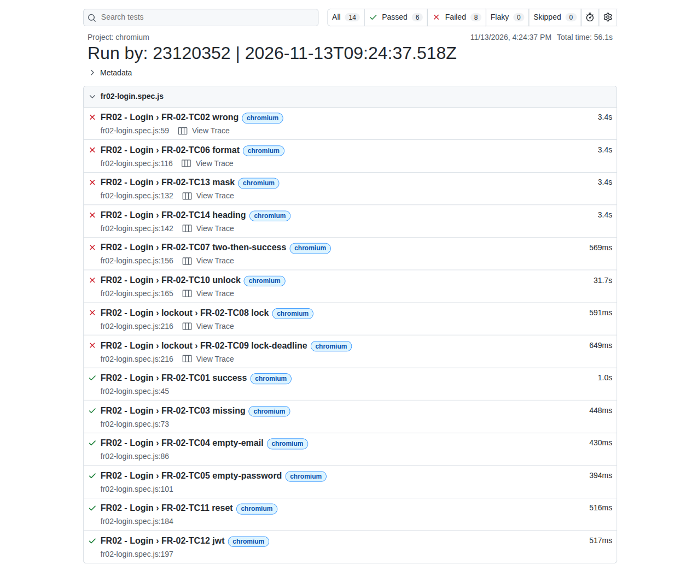

#### 5.1.6 Test case không automate được

Không có case nào trong14case đã duyệt bị bỏ automation. JWT chỉ kiểm tra lưu/truyền token, không xác minh chữ ký mật mã.

#### 5.1.7 Bug tìm thấy

| Bug | Cases | Issue có screenshot |
| --- | --- | --- |
| BUG-01 | FR-02-TC02, FR-02-TC07 | [#1](https://github.com/quocthaiLN/HW04-SoftwareTesting/issues/1) |
| BUG-02 | FR-02-TC08, FR-02-TC09, FR-02-TC10 | [#2](https://github.com/quocthaiLN/HW04-SoftwareTesting/issues/2) |
| BUG-03 | FR-02-TC06 | [#3](https://github.com/quocthaiLN/HW04-SoftwareTesting/issues/3) |
| BUG-04 | FR-02-TC13 | [#4](https://github.com/quocthaiLN/HW04-SoftwareTesting/issues/4) |
| BUG-05 | FR-02-TC14 | [#5](https://github.com/quocthaiLN/HW04-SoftwareTesting/issues/5) |

Chi tiết expected/actual và ảnh cục bộ tại mục7 và [báo cáo bug tại mục 7](Main-Report.md#7-bug-report).

### 5.2. Feature B — FR-09

#### 5.2.1 Mô tả feature

Áp coupon qua UI; kiểm tra success/error/auth, điều kiện ngưỡng/lượt dùng, uppercase/trim payload, cap discount bằng total, final>=0 và floor phần trăm. Auth, sản phẩm và apply coupon dùng backend thật; giỏ hàng nằm trong React state thật.

#### 5.2.2 Danh sách test case tự động hóa

Loại positive/negative/edge là phân loại báo cáo theo mục tiêu chính của case. Status dưới đây ghi số lượt P/F/S trên ba engines.

| ID | Loại | Mô tả | File data | Assertion pattern | P/F/S |
| --- | --- | --- | --- | --- | --- |
| FR-09-TC01 | positive | Percent hợp lệ | data/fr09.json | toHaveText, toEqual(payload), toHaveLength | 0/3/0 |
| FR-09-TC02 | positive | Fixed hợp lệ | data/fr09.json | toHaveText, toEqual(payload), toHaveLength | 3/0/0 |
| FR-09-TC03 | negative | Không tồn tại | data/fr09.json | toHaveText, toEqual(payload), toHaveLength | 3/0/0 |
| FR-09-TC04 | negative | Inactive | data/fr09.json | toHaveText, toEqual(payload), toHaveLength | 3/0/0 |
| FR-09-TC05 | negative | Hết hạn | data/fr09.json | toHaveText, toEqual(payload), toHaveLength | 3/0/0 |
| FR-09-TC06 | edge | Dưới ngưỡng 1 đồng | data/fr09.json | toHaveText, toEqual(payload), toHaveLength | 3/0/0 |
| FR-09-TC07 | edge | Đúng ngưỡng | data/fr09.json | toHaveText, toEqual(payload), toHaveLength | 0/3/0 |
| FR-09-TC08 | edge | Trên ngưỡng 1 đồng | data/fr09.json | toHaveText, toEqual(payload), toHaveLength | 3/0/0 |
| FR-09-TC09 | negative | Chưa đăng nhập | data/fr09.json | toHaveURL / toBeVisible, toHaveLength | 3/0/0 |
| FR-09-TC10 | negative | JWT không hợp lệ | data/fr09.json | toHaveURL / toBeVisible, toHaveLength | 3/0/0 |
| FR-09-TC11 | edge | Còn một lượt | data/fr09.json | toHaveText, toEqual(payload), toHaveLength | 3/0/0 |
| FR-09-TC12 | edge | Hết lượt | data/fr09.json | toHaveText, toEqual(payload), toHaveLength | 3/0/0 |
| FR-09-TC13 | edge | Mã coupon trống | data/fr09.json | toBeDisabled, toHaveLength | 3/0/0 |
| FR-09-TC14 | edge | Mã chỉ chứa khoảng trắng | data/fr09.json | toBeDisabled, toHaveLength | 3/0/0 |
| FR-09-TC15 | positive | Chuẩn hóa mã chữ thường trong request | data/fr09.json | toHaveText, toEqual(payload), toHaveLength | 3/0/0 |
| FR-09-TC16 | positive | Trim khoảng trắng đầu/cuối trong request | data/fr09.json | toHaveText, toEqual(payload), toHaveLength | 3/0/0 |
| FR-09-TC17 | edge | Giảm đúng bằng tổng đơn hàng | data/fr09.json | toHaveText, toEqual(payload), toHaveLength | 3/0/0 |
| FR-09-TC18 | edge | Tiền sau áp dụng không âm khi giảm vượt tổng | data/fr09.json | toHaveText, toEqual(payload), toHaveLength | 0/3/0 |
| FR-09-TC19 | edge | Làm tròn xuống tiền giảm phần trăm có phần lẻ | data/fr09.json | toHaveText, toEqual(payload), toHaveLength | 0/3/0 |

#### 5.2.3 Test data

[data/fr09.json](data/fr09.json) chứa product/input/authMode/policy/expected cho 19 IDs. Fixture tạo user/product/coupon/usage thật theo policy; mã unique giữ nguyên tình huống lowercase/trim. Expected độc lập với response backend.

```json
{
  "id": "FR-09-TC01",
  "feature": "FR-09",
  "scenario": "success",
  "input": {
    "code": "BIGBUY",
    "total": 500000
  },
  "authMode": "valid",
  "expected": {
    "code": "BIGBUY",
    "total": 500000,
    "discount": 50000,
    "final": 450000,
    "applyCount": 1,
    "checkoutCount": 0,
    "statuses": [
      200
    ],
    "errorPattern": null
  },
  "policy": {
    "kind": "percent",
    "value": 10,
    "min": 300000,
    "uses": 0,
    "maxUses": 1,
    "active": true,
    "expiry": "2099-12-31",
    "exists": true
  },
  "product": {
    "name": "FR09 cart product",
    "price": 500000,
    "quantity": 1
  }
}
```

#### 5.2.4 Script và lifecycle

[Spec](tests/fr09-apply-coupon.spec.js) dùng [coupon-real fixture](tests/fixtures/coupon-real.js) và Login/Home/Cart/Checkout POM. Fixture seed dữ liệu riêng, quan sát request thụ động, đính kèm response thực tế và dọn các row sở hữu kể cả khi fail. Sau khi thêm hàng, điều hướng bằng UI để giữ CartContext; không sửa ô tổng tiền, không mock module/API. Response wait được đăng ký trước click Áp dụng. Assertions tiền dùng soft để tiếp tục thu evidence UI; mismatch vẫn làm test fail.

Ví dụ callback thành công từ code hiện tại:

```javascript
for (const record of records.filter(r => r.scenario === 'success')) {
  test.describe(record.id, () => {
    test.use({ couponRecord: record });
    test(`${record.id} success [real UI + backend]`, async ({ page, testUser, db, couponState: state }) => {
      const checkout = await authenticatedCheckout(page, state, record, testUser);
      const body = await apply(checkout, state, record, page, testUser);
      expect.soft(body).toMatchObject({ success: true, coupon_id: state.couponId, discount_amount: record.expected.discount, final_amount: record.expected.final });
      await expect.soft(checkout.savings).toHaveText(shared.ui.savingsPrefix + currency(record.expected.discount));
      await expect.soft(checkout.final).toHaveText(shared.ui.finalPrefix + currency(record.expected.final));
      await expect.soft(checkout.payable).toHaveText(shared.ui.totalPrefix + currency(record.expected.final));
      await noPayment(db, state, record);
    });
  });
}
```

#### 5.2.5 Kết quả thực thi

| Browser | Pass | Fail | Skip | HTML report |
| --- | ---: | ---: | ---: | --- |
| chromium | 15 | 4 | 0 | [HTML](artifacts/session006-fr09-real-chromium/html/index.html) |
| firefox | 15 | 4 | 0 | [HTML](artifacts/session006-fr09-real-firefox/html/index.html) |
| webkit | 15 | 4 | 0 | [HTML](artifacts/session006-fr09-real-webkit/html/index.html) |

HTML là output runner thật của Session006; đã mở kiểm tra attribution, ISO và project ở lượt rà soát cuối. Ảnh xác minh mới bên dưới, không chỉnh HTML runner.

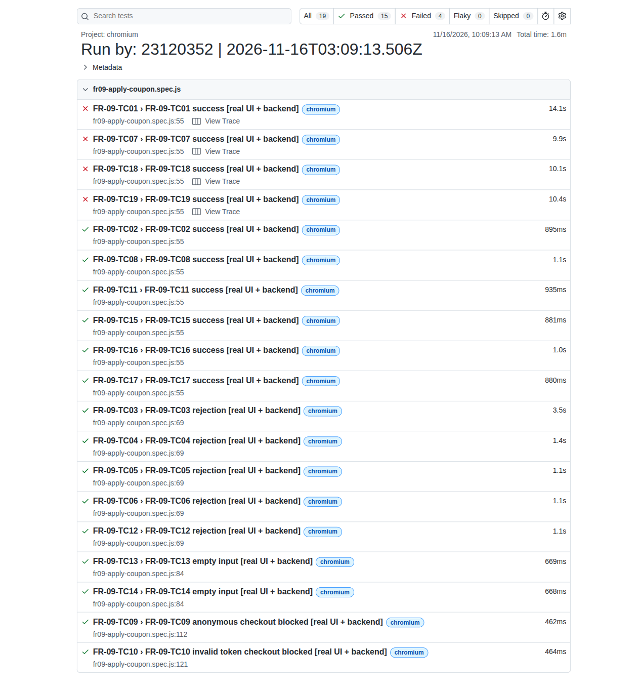

[FR09 real execution matrix](artifacts/session006-fr09-real/execution-matrix.json). Báo cáo HTML thật ở bảng trên; không giữ ảnh attribution của batch mock cũ.

| Case | Expected | Actual backend response |
| --- | --- | --- |
| TC01 percent10%, total500,000 | discount50,000; final450,000 | HTTP200; discount-4,500,000; final5,000,000 |
| TC07 total=min300,000 | HTTP200; discount50,000; final250,000 | HTTP400; minimum value rejection |
| TC18 fixed100,000 on total80,000 | capped discount80,000; final0 | HTTP200; discount100,000; final-20,000 |
| TC19 percent10%, total333,333 | floored discount33,333; final300,000 | HTTP200; discount-2,999,997; final3,333,330 |

These are three backend defect groups: wrong percentage formula, strict `>` minimum check, no discount cap. SUT and business expected values were not changed to make tests pass. test-cases.json records these actual runs, with old mock results preserved under historical_mock_execution_results.

Cleanup verified: zero products with owned fixture marker, zero generated test users, zero coupon_usage rows and only four original seed coupons remaining. Validator passes68cases and registration check reports57FR09tests. Failed test screenshots/traces and actual-response attachments are in runner artifacts; GitHub publication was pending at execution time; see the subsequent publication below.


#### 5.2.6 Test case không automate được

19/19 case đã automate. TC09/TC10 kiểm tra UI guard tại cart và token invalid ở /users/me, không chứng minh direct apply endpoint enforcement. Không xác nhận tạo đơn/ghi lượt dùng khi thanh toán; không kiểm thử API giỏ hàng vì SUT lưu giỏ trong React state.

#### 5.2.7 Bug tìm thấy

Bốn case TC01/TC07/TC18/TC19 fail trên cả ba engines, tương ứng BUG-10 (công thức percent), BUG-11 (bằng ngưỡng tối thiểu), BUG-12 (thiếu cap mức giảm). Chi tiết và ảnh tại mục 7.


Chi tiết expected/actual và ảnh cục bộ tại mục7 và [báo cáo bug tại mục 7](Main-Report.md#7-bug-report).

### 5.3. Feature C — FR-17

#### 5.3.1 Mô tả feature

Admin Create/Read/Delete coupon; percent nguyên1–100, fixed>0, minimum>=0; code/expiry/value bắt buộc; lượt dùng>=1 nguyên; duplicate trả400/409 + lỗi thân thiện; quyền user/anonymous qua UI.

#### 5.3.2 Danh sách test case tự động hóa

Loại positive/negative/edge là phân loại báo cáo theo mục tiêu chính của case. Status dưới đây ghi số lượt P/F/S trên ba engines.

| ID | Loại | Mô tả | File data | Assertion pattern | P/F/S |
| --- | --- | --- | --- | --- | --- |
| FR-17-TC01 | positive | Create percent | data/fr17.json | toHaveText / toHaveValue / toHaveCount; status/DB theo scenario | 3/0/0 |
| FR-17-TC02 | positive | Create fixed | data/fr17.json | toHaveText / toHaveValue / toHaveCount; status/DB theo scenario | 3/0/0 |
| FR-17-TC03 | positive | Read fields | data/fr17.json | toHaveText / toHaveValue / toHaveCount; status/DB theo scenario | 3/0/0 |
| FR-17-TC04 | positive | Delete | data/fr17.json | toHaveText / toHaveValue / toHaveCount; status/DB theo scenario | 3/0/0 |
| FR-17-TC05 | negative | Duplicate code | data/fr17.json | toHaveText / toHaveValue / toHaveCount; status/DB theo scenario | 0/3/0 |
| FR-17-TC06 | negative | Code bắt buộc | data/fr17.json | toBeFalsy(validity), toHaveLength | 3/0/0 |
| FR-17-TC07 | negative | Value bắt buộc | data/fr17.json | toBeFalsy(validity), toHaveLength | 3/0/0 |
| FR-17-TC08 | edge | Value bằng 0 | data/fr17.json | toContain(status), toHaveLength(DB), toHaveCount | 0/3/0 |
| FR-17-TC09 | edge | Value âm | data/fr17.json | toContain(status), toHaveLength(DB), toHaveCount | 0/3/0 |
| FR-17-TC10 | edge | Min order âm | data/fr17.json | toContain(status), toHaveLength(DB), toHaveCount | 0/3/0 |
| FR-17-TC11 | edge | Expiry bắt buộc | data/fr17.json | toBeFalsy(validity), toHaveLength | 3/0/0 |
| FR-17-TC12 | edge | Uses dưới 1 | data/fr17.json | toBeFalsy(validity), toHaveLength | 3/0/0 |
| FR-17-TC13 | positive | Create fixed với đơn tối thiểu 0 | data/fr17.json | toHaveText / toHaveValue / toHaveCount; status/DB theo scenario | 3/0/0 |
| FR-17-TC14 | positive | Create ngày quá khứ và nhãn Hết hạn | data/fr17.json | toHaveText / toHaveValue / toHaveCount; status/DB theo scenario | 3/0/0 |
| FR-17-TC15 | positive | Uppercase mã khi nhập trên admin | data/fr17.json | toHaveText / toHaveValue / toHaveCount; status/DB theo scenario | 3/0/0 |
| FR-17-TC16 | positive | Reset form sau khi tạo thành công | data/fr17.json | toHaveText / toHaveValue / toHaveCount; status/DB theo scenario | 3/0/0 |
| FR-17-TC17 | edge | Biên percent hợp lệ: 1% | data/fr17.json | toHaveText / toHaveValue / toHaveCount; status/DB theo scenario | 3/0/0 |
| FR-17-TC18 | edge | Biên percent hợp lệ: 2% | data/fr17.json | toHaveText / toHaveValue / toHaveCount; status/DB theo scenario | 3/0/0 |
| FR-17-TC19 | edge | Biên percent hợp lệ: 50% | data/fr17.json | toHaveText / toHaveValue / toHaveCount; status/DB theo scenario | 3/0/0 |
| FR-17-TC20 | edge | Biên percent hợp lệ: 99% | data/fr17.json | toHaveText / toHaveValue / toHaveCount; status/DB theo scenario | 3/0/0 |
| FR-17-TC21 | edge | Biên percent hợp lệ: 100% | data/fr17.json | toHaveText / toHaveValue / toHaveCount; status/DB theo scenario | 3/0/0 |
| FR-17-TC22 | edge | Biên fixed dương: 1 đồng | data/fr17.json | toHaveText / toHaveValue / toHaveCount; status/DB theo scenario | 3/0/0 |
| FR-17-TC23 | edge | Biên fixed dương: 2 đồng | data/fr17.json | toHaveText / toHaveValue / toHaveCount; status/DB theo scenario | 3/0/0 |
| FR-17-TC24 | edge | Fixed không dương: 0 | data/fr17.json | toContain(status), toHaveLength(DB), toHaveCount | 0/3/0 |
| FR-17-TC25 | edge | Fixed không dương: -50000 | data/fr17.json | toContain(status), toHaveLength(DB), toHaveCount | 0/3/0 |
| FR-17-TC26 | edge | Đơn tối thiểu sát biên hợp lệ: 1 đồng | data/fr17.json | toHaveText / toHaveValue / toHaveCount; status/DB theo scenario | 3/0/0 |
| FR-17-TC27 | edge | Lượt dùng âm | data/fr17.json | toBeFalsy(validity), toHaveLength | 3/0/0 |
| FR-17-TC28 | edge | Lượt dùng thập phân qua UI | data/fr17.json | toBeFalsy(validity), toHaveLength | 3/0/0 |
| FR-17-TC29 | positive | Lượt dùng danh định: 10 | data/fr17.json | toHaveText / toHaveValue / toHaveCount; status/DB theo scenario | 3/0/0 |
| FR-17-TC32 | edge | Percent không hợp lệ: 101 | data/fr17.json | toContain(status), toHaveLength(DB), toHaveCount | 0/3/0 |
| FR-17-TC33 | edge | Percent không hợp lệ: 120 | data/fr17.json | toContain(status), toHaveLength(DB), toHaveCount | 0/3/0 |
| FR-17-TC34 | edge | Percent không hợp lệ: 0.5 | data/fr17.json | toContain(status), toHaveLength(DB), toHaveCount | 0/3/0 |
| FR-17-TC35 | edge | Percent không hợp lệ: 1.5 | data/fr17.json | toContain(status), toHaveLength(DB), toHaveCount | 0/3/0 |
| FR-17-TC36 | negative | Chặn user thường truy cập quản lý coupon | data/fr17.json | toHaveText / toHaveValue / toHaveCount; status/DB theo scenario | 3/0/0 |
| FR-17-TC37 | negative | Chặn truy cập coupon khi chưa đăng nhập | data/fr17.json | toHaveText / toHaveValue / toHaveCount; status/DB theo scenario | 3/0/0 |

#### 5.3.3 Test data

[data/fr17.json](data/fr17.json) là mảng records; ID ánh xạ testcase. FR-17 records chứa overrides và expected; merge với couponDefaults trong data/shared.json, resolve code unique và expiry offset.

```json
{
  "id": "FR-17-TC01",
  "feature": "FR-17",
  "scenario": "create",
  "overrides": {},
  "expected": {
    "persist": true,
    "expired": false,
    "htmlOnly": false,
    "rowCount": 1
  }
}
```


#### 5.3.4 Script sau khi sửa

[tests/fr17-coupons.spec.js](tests/fr17-coupons.spec.js); đoạn trích nguyên bản hiện tại:

```javascript
expect(await coupons.form.evaluate(form => form.checkValidity())).toBeTruthy();
        const responsePromise = page.waitForResponse(r => new URL(r.url()).pathname === '/api/admin/coupons' && r.request().method() === 'POST');
        await coupons.create.click();
        const response = await responsePromise;
        await couponTest.info().attach('creation-response', {
          body: JSON.stringify({
            status: response.status(),
            body: await response.text()
          }),
          contentType: 'application/json'
        });
        expect.soft(shared.invalidStatuses).toContain(response.status());
        await coupons.reload();
        const persisted = await db.all('SELECT id FROM coupons WHERE code=?', [savedCode]);
        expect.soft(persisted).toHaveLength(record.expected.rowCount);
        await expect(coupons.row(savedCode)).toHaveCount(record.expected.rowCount);
      });
```


#### 5.3.5 Kết quả thực thi

| Browser | Pass | Fail | Skip | HTML report |
| --- | ---: | ---: | ---: | --- |
| chromium | 25 | 10 | 0 | [HTML](artifacts/session004-refactor-fr17-chromium/html/index.html) |
| firefox | 25 | 10 | 0 | [HTML](artifacts/session004-refactor-fr17-firefox/html/index.html) |
| webkit | 25 | 10 | 0 | [HTML](artifacts/session004-refactor-fr17-webkit/html/index.html) |

Ảnh report Chromium có Run by và ISO; Firefox/WebKit đã được kiểm tra trong report-verification.json, ảnh tương ứng nằm trong từng run.

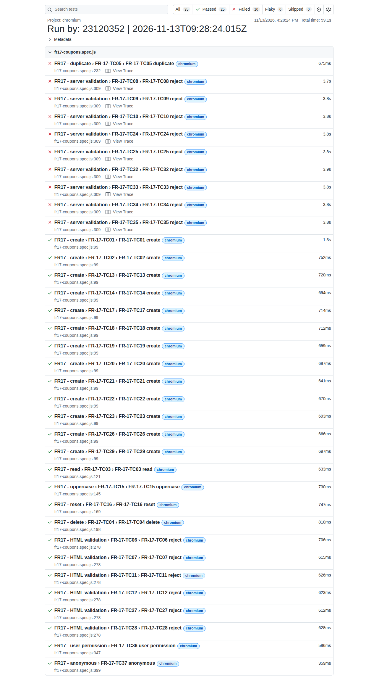

#### 5.3.6 Test case không automate được

35/35case đã automate. Update không hỗ trợ ở SUT; TC30/31 code-length đã retired theo sinh viên, không tính vào68. Endpoint role enforcement trực tiếp và used-coupon-delete ngoài scope.

#### 5.3.7 Bug tìm thấy

| Bug | Cases | Issue có screenshot |
| --- | --- | --- |
| BUG-06 | FR-17-TC05 | [#6](https://github.com/quocthaiLN/HW04-SoftwareTesting/issues/6) |
| BUG-07 | FR-17-TC08, FR-17-TC09, FR-17-TC32, FR-17-TC33, FR-17-TC34, FR-17-TC35 | [#7](https://github.com/quocthaiLN/HW04-SoftwareTesting/issues/7) |
| BUG-08 | FR-17-TC24, FR-17-TC25 | [#8](https://github.com/quocthaiLN/HW04-SoftwareTesting/issues/8) |
| BUG-09 | FR-17-TC10 | [#9](https://github.com/quocthaiLN/HW04-SoftwareTesting/issues/9) |

Chi tiết expected/actual và ảnh cục bộ tại mục7 và [báo cáo bug tại mục 7](Main-Report.md#7-bug-report).

## 6. Review & Gap Analysis các script do AI sinh (human review)

Sinh viên chấp nhận refactor Conditional Test Logic lúc16:40 và xác nhận selectors/assertions/waits/missing cases/gap analysis lúc16:50 ngày13/11/2026. Các nhãn “không có” dưới đây phản ánh review cuối của sinh viên, không xóa lịch sử AI self-review trước đó.

| Hạng mục | Kết quả review | Nguyên nhân / xử lý |
| --- | --- | --- |
| Selector dễ vỡ | Không có theo review cuối | Role/form/table và scoped inputs; không phát sinh yêu cầu sửa selector |
| Assertion yếu/thiếu | Không có trong review cuối | Lịch sử AI self-review từng sửa currency substring thành exact; giữ lại phân biệt giai đoạn |
| Thiếu edge case | Có ở thiết kế ban đầu | Model chưa phủ đủ BVA; sinh viên bổ sung ở bước testcase design, trước automation; FR-17 có1/2/99/100/101, số âm và thập phân |
| Flaky wait/hard-coded sleep | Không có theo review cuối | Auto-wait/response/poll; TC10 đợi31giây business policy từ JSON, không tùy ý chờ UI |
| Data hardcode | Không có theo review cuối | JSON tách riêng; validator giữ68IDs và expected bắt buộc |
| Khác biệt browser | Không có status khác nhau trong batch hiện hành | Mỗi case có cùng status trên3engines; không tuyên bố không thể có khác biệt ngoài suite |
| Conditional Test Logic | Có; đã sửa và được chấp nhận | AI ưu tiên dispatcher để tái sử dụng, trộn hành vi; tách callback, chỉ data-drive nhóm đồng dạng |

Prompt cần tách “cùng dữ liệu” và “cùng hành vi”; giới hạn model là ưu tiên giảm duplication quá mức. Đặc thù SUT (label không gắn id, business time, cart không fetch API) cần fixture/POM và scope rõ. Luồng được skill chuẩn hóa nên cấu trúc từng feature ổn định và đồng đều; bằng chứng giới hạn ở hai batch cùng204keys/0statusdifferences và matrix Session004, không phải chứng minh thống kê flake rate.

### Before/after Conditional Test Logic

Before — trích baseline Git `676a70e`:


```javascript
for (const record of read('fr02')) {
  test(`${record.id} ${record.scenario}`, async ({ page, db, testUser }) => {
    const login = new LoginPage(page);
    const requests = [];
    page.on('request', request => { if (new URL(request.url()).pathname === '/api/login') requests.push(request.method()); });
    await login.goto();
    const scenario = record.scenario;
    if (scenario === 'success') {
      const response = await login.login(testUser.email, testUser.password);
      expect(response.status()).toBe(shared.expected.successStatus);
      await expect(page).toHaveURL('/');
      await expect(page.getByRole('link', { name: new RegExp(testUser.name) })).toBeVisible();
      expect(await page.evaluate(key => !!localStorage.getItem(key), shared.expected.tokenKey)).toBeTruthy();
    } else if (scenario === 'wrong' || scenario === 'missing') {
```

After — trích script hiện tại:

```javascript
testUser,
    login
  }) => {
    const response = await login.login(testUser.email, testUser.password);
    expect(response.status()).toBe(shared.expected.successStatus);
    await expect(page).toHaveURL('/');
    await expect(page.getByRole('link', {
      name: new RegExp(testUser.name)
    })).toBeVisible();
    expect(await page.evaluate(key => !!localStorage.getItem(key), shared.expected.tokenKey)).toBeTruthy();
  });
  test(title('wrong'), async ({
    page,
    db,
    testUser,
    login
  }) => {
    const response = await login.login(testUser.email, shared.wrongPassword);
    expect(shared.expected.failureStatus).toContain(response.status());
    await expect(page.getByText(shared.expected.error, {
      exact: true
    })).toBeVisible();
    expect(await page.evaluate(key => localStorage.getItem(key), shared.expected.tokenKey)).toBe(shared.null);
    await expect.poll(async () => (await db.get('SELECT login_attempts FROM users WHERE id=?', [testUser.id])).login_attempts).toBe(shared.expected.one);
```

### Tỷ lệ phần AI sinh được giữ/sửa

Số liệu lịch sử đo tại Session005 trên 3 file `.spec.js`: baseline `676a70e` trước human refactor so với bản sau refactor Session004. Bảng này không đo lại thay đổi FR09 backend thật của Session006. Token hóa identifier/số/dấu bằng regex `\w+|[^\w\s]`, bỏ whitespace; SequenceMatcher autojunk=False. “Giữ” là token baseline còn khớp theo thứ tự; “sửa/xóa” là phần còn lại. Đây là chỉ số thay đổi văn bản, không là tỷ lệ công sức hay chất lượng.

| Spec | Token baseline | Giữ | Sửa/xóa | Giữ % | Sửa/xóa % |
| --- | ---: | ---: | ---: | ---: | ---: |
| fr02-login | 1670 | 959 | 711 | 57.4% | 42.6% |
| fr09-apply-coupon | 901 | 564 | 337 | 62.6% | 37.4% |
| fr17-coupons | 2045 | 749 | 1296 | 36.6% | 63.4% |

Bổ sung BVA ở thiết kế không được đếm nhầm là sửa script sau chạy. AI Critique do sinh viên cung cấp được giữ nguyên văn tại Appendix B.

## 7. Bug Report

12 nhóm defect: BUG-01–09 thuộc FR-02/FR-17; BUG-10–12 thuộc FR-09 backend thật. Các báo cáo dưới chứa steps, expected/actual và screenshot runner; severity là đề xuất. Giới hạn screenshot được nêu tại từng bug. Các lỗi script/report và timeout môi trường được phân loại riêng.

| ID | Case IDs | Expected | Actual runtime | Mức ảnh hưởng |
| --- | --- | --- | --- | --- |
| BUG-01 | FR-02-TC02, TC07 | Mỗi lần sai tăng 1; hai lần sai chưa khóa | DB counter=2 sau một lần sai; login đúng sau hai lần sai trả 403 | Khóa account sớm |
| BUG-02 | FR-02-TC08–TC10 | Khóa theo policy 30 giây; login đúng ở mốc 31 giây thành công | locked_until xấp xỉ 180 giây; sau 31 giây vẫn 403 | Thời gian khóa sai |
| BUG-03 | FR-02-TC06 | Email HTML5 chặn abc, không POST login | type=text, validity.valid=true, form gửi login | Validation email thiếu |
| BUG-04 | FR-02-TC13 | type=password và glyph che | type=text; screenshot thấy nguyên mật khẩu test | Lộ mật khẩu khi nhập |
| BUG-05 | FR-02-TC14 | Heading nhận diện Đăng nhập | Heading Đăng Ký | Nhận diện luồng sai |
| BUG-06 | FR-17-TC05 | Duplicate HTTP400/409, lỗi nghiệp vụ thân thiện | HTTP500; alert chứa SQLITE_CONSTRAINT/UNIQUE constraint failed: coupons.code | Lộ lỗi nội bộ và sai contract lỗi |
| BUG-07 | FR-17-TC08/09/32–35 | Percent nguyên trong 1–100 | Các giá trị 0/-1/101/120/0.5/1.5 nhận HTTP200 và lưu sau reload | Dữ liệu percent sai |
| BUG-08 | FR-17-TC24/25 | Fixed phải dương | Fixed 0/-50000 nhận HTTP200 và persist | Dữ liệu fixed sai |
| BUG-09 | FR-17-TC10 | Min order không âm | Min=-1 nhận HTTP200 và persist | Dữ liệu min order sai |
| BUG-10 | FR-09-TC01/TC19 | Percent /100, floor | Discount âm; final lớn hơn tổng | Công thức sai |
| BUG-11 | FR-09-TC07 | Tổng bằng ngưỡng được chấp nhận | HTTP400 | Sai biên tối thiểu |
| BUG-12 | FR-09-TC18 | Cap discount bằng tổng, final=0 | final=-20000 | Thành tiền âm |

### Tái hiện chung

FR-02: start SUT cô lập theo mục 3 của Main-Report.md, tạo test account qua fixture từ data/shared.json, chạy case tương ứng bằng --grep và --project. Login qua UI; counters/deadline đọc SQLite riêng, không sửa deadline trong bước đo. TC10 thực sự đợi 31 giây, không page.clock.

FR-17: fixture tạo admin test và login setup API thật, mở admin app/tab Mã Giảm Giá; điền dữ liệu từ data/fr17.json với shared defaults. Case duplicate seed một code riêng rồi tạo lại qua UI; invalid cases không bypass HTML validation. Đối chiếu HTTP response, bảng sau reload và SQLite read-only assertions. Cleanup xóa coupon/account thuộc case sau khi thu kết quả.

### Phân loại riêng lỗi thực thi

Batch session003-full có FR-09-TC07/WebKit timeout tại actionability click (8 giây), trước request apply. Chưa có bằng chứng đây là lỗi SUT; không cộng vào 9 defect groups. Trong batch đó có mở browser khác để kiểm tra report khi WebKit đang chạy; mất foreground/animation scheduling là giả thuyết, chưa xác minh nguyên nhân. Batch final không mở thêm browser quan sát trong lúc tests chạy; kết quả cũ đã được xóa trong cleanup, lịch sử ghi trong Git/audit.

### Review AI đã sửa

Assertion tiền ban đầu dùng toContainText có thể nhận nhầm số dài hơn hoặc chuỗi có 0. Đã sửa toHaveText với prefixes/suffixes từ JSON và chạy lại suite. Custom metadata trong reporter 1.65 mặc định ẩn fields khác nếu không bật show-metadata-other; đã cấu hình title có attribution và ISO ngay từ runtime. Đây là self-review AI, không phải xác nhận human review của sinh viên.

### Final evidence

Batch Session004 lịch sử trước khi thay FR09: 150 pass/54 fail/0 skipped. FR-09 mock khi đó đạt57/57; timeout batch đầu không lặp lại, nguyên nhân gốc vẫn chưa kết luận.

| Bug | Case | Screenshot | Report |
| --- | --- | --- | --- |
| BUG-01 | FR-02-TC02 / Chromium | [Actual screenshot](artifacts/evidence/BUG-01.png) | [Actual report](artifacts/session004-refactor-fr02-chromium/html/index.html) |
| BUG-02 | FR-02-TC10 / Chromium | [Actual screenshot](artifacts/evidence/BUG-02.png) | [Actual report](artifacts/session004-refactor-fr02-chromium/html/index.html) |
| BUG-03 | FR-02-TC06 / Chromium | [Actual screenshot](artifacts/evidence/BUG-03.png) | [Actual report](artifacts/session004-refactor-fr02-chromium/html/index.html) |
| BUG-04 | FR-02-TC13 / Chromium | [Actual screenshot](artifacts/evidence/BUG-04.png) | [Actual report](artifacts/session004-refactor-fr02-chromium/html/index.html) |
| BUG-05 | FR-02-TC14 / Chromium | [Actual screenshot](artifacts/evidence/BUG-05.png) | [Actual report](artifacts/session004-refactor-fr02-chromium/html/index.html) |
| BUG-06 | FR-17-TC05 / Chromium | [Actual screenshot](artifacts/evidence/BUG-06.png) | [Actual report](artifacts/session004-refactor-fr17-chromium/html/index.html) |
| BUG-07 | FR-17-TC32 / Chromium | [Actual screenshot](artifacts/evidence/BUG-07.png) | [Actual report](artifacts/session004-refactor-fr17-chromium/html/index.html) |
| BUG-08 | FR-17-TC24 / Chromium | [Actual screenshot](artifacts/evidence/BUG-08.png) | [Actual report](artifacts/session004-refactor-fr17-chromium/html/index.html) |
| BUG-09 | FR-17-TC10 / Chromium | [Actual screenshot](artifacts/evidence/BUG-09.png) | [Actual report](artifacts/session004-refactor-fr17-chromium/html/index.html) |

Screenshot duplicate được chụp sau alert đã được đóng; xem dialog text/response trong lỗi runner và trace, không suy ra nội dung alert từ ảnh bảng. Các ảnh được copy từ output runner, không tạo/sửa hình.

### Session 005 — GitHub Issues và báo cáo chi tiết

Đối chiếu đề §6 p.4 và §14 p.7; hoàn tất REQ-12 lúc 2026-11-13T17:11:43+07:00. Đã tạo và mở kiểm tra từng Issue, mỗi Issue có một screenshot gốc từ runner. [Danh sách Issues](https://github.com/quocthaiLN/HW04-SoftwareTesting/issues); ảnh xác minh danh sách: [session005-github-issues.png](artifacts/evidence/session005-github-issues.png).

Các kết quả Session003/004 là evidence đã chạy, không phải lượt chạy mới. Playwright Test 1.65.0; Node v24.21.0; Linux; Chromium 158.0.8127.18 / Firefox 159.0 / WebKit 27.2 (artifacts/session004-refactor/execution-matrix.json). Test revision Session004: `3cd7cc68e83c3f3417b31a02a47231df5f3e54e0`. SUT nguyên trạng, backend/SQLite cô lập, ports API3000/web5173/admin5174. FR-02/17 không mock API. Setup và cleanup theo mục 3 của Main-Report.md; dữ liệu trong data/shared.json và data/fr02.json/data/fr17.json.

Policy integer percent 1–100, fixed>0 và min>=0 theo testcase design/scope đã được sinh viên chốt. Severity dưới đây là đề xuất của báo cáo, chưa phải đánh giá của maintainer. Status Open, chưa sửa SUT. 54 executions fail = 18 case IDs × 3 browsers; được gộp thành 9 defect groups, không báo thành 54 bugs.

| Bug | GitHub Issue | Cases |
| --- | --- | --- |
| BUG-01 | [#1](https://github.com/quocthaiLN/HW04-SoftwareTesting/issues/1) | FR-02-TC02, FR-02-TC07 |
| BUG-02 | [#2](https://github.com/quocthaiLN/HW04-SoftwareTesting/issues/2) | FR-02-TC08, FR-02-TC09, FR-02-TC10 |
| BUG-03 | [#3](https://github.com/quocthaiLN/HW04-SoftwareTesting/issues/3) | FR-02-TC06 |
| BUG-04 | [#4](https://github.com/quocthaiLN/HW04-SoftwareTesting/issues/4) | FR-02-TC13 |
| BUG-05 | [#5](https://github.com/quocthaiLN/HW04-SoftwareTesting/issues/5) | FR-02-TC14 |
| BUG-06 | [#6](https://github.com/quocthaiLN/HW04-SoftwareTesting/issues/6) | FR-17-TC05 |
| BUG-07 | [#7](https://github.com/quocthaiLN/HW04-SoftwareTesting/issues/7) | FR-17-TC08, FR-17-TC09, FR-17-TC32, FR-17-TC33, FR-17-TC34, FR-17-TC35 |
| BUG-08 | [#8](https://github.com/quocthaiLN/HW04-SoftwareTesting/issues/8) | FR-17-TC24, FR-17-TC25 |
| BUG-09 | [#9](https://github.com/quocthaiLN/HW04-SoftwareTesting/issues/9) | FR-17-TC10 |

#### [BUG-01][FR-02] Failed login increments attempts twice and locks account early

- Issue: [#1](https://github.com/quocthaiLN/HW04-SoftwareTesting/issues/1); Open; severity đề xuất: Major.
- Cases: FR-02-TC02, FR-02-TC07; fail trên cả ba engines, hai batch đã lưu.

**Bước tái hiện** (SUT đã chạy theo mục 3 của Main-Report.md):

1. Start isolated SUT per mục 3 của Main-Report.md; create a fresh user (attempts=0, locked_until=null).
2. Open /login and submit one wrong password; read the isolated SQLite row.
3. On another fresh account, submit two wrong passwords then the correct password.

**Expected:** Increment exactly 1 per failed attempt; two failures still allow a correct login.

**Actual:** Counter=2 after one failure; correct password after two failures receives HTTP403.

Lệnh chạy lại (sẽ tạo execution mới, chưa chạy trong Session005):

```bash
npx playwright test tests/fr02-login.spec.js --project=chromium --grep "FR-02-TC02|FR-02-TC07"
```

**Evidence:** Screenshot shows the UI after failure. Counter and HTTP result are established by runner/trace, not the image alone. Xem lỗi assertion/attachments trong matrix nêu trên và HTML report Session003 tương ứng trong bảng Final evidence.


#### [BUG-02][FR-02] Account remains locked after the required 30 seconds

- Issue: [#2](https://github.com/quocthaiLN/HW04-SoftwareTesting/issues/2); Open; severity đề xuất: Major.
- Cases: FR-02-TC08, FR-02-TC09, FR-02-TC10; fail trên cả ba engines, hai batch đã lưu.

**Bước tái hiện** (SUT đã chạy theo mục 3 của Main-Report.md):

1. Start isolated SUT per mục 3 của Main-Report.md; create a fresh account (attempts=0, locked_until=null).
2. Open /login and submit three wrong passwords.
3. Read locked_until from isolated SQLite without changing it.
4. Wait 31 real seconds after the third attempt, then submit the correct password.

**Expected:** Lock duration is 30 seconds; correct login succeeds at 31 seconds (HTTP200).

**Actual:** Deadline is approximately 180 seconds; correct login after 31 seconds returns HTTP403.

Lệnh chạy lại (sẽ tạo execution mới, chưa chạy trong Session005):

```bash
npx playwright test tests/fr02-login.spec.js --project=chromium --grep "FR-02-TC08|FR-02-TC09|FR-02-TC10"
```

**Evidence:** Screenshot shows rejected login; deadline and elapsed time are evidenced by lock-state-before attachment and runner/trace. Counter defect is tracked separately as BUG-01. Xem lỗi assertion/attachments trong matrix nêu trên và HTML report Session003 tương ứng trong bảng Final evidence.

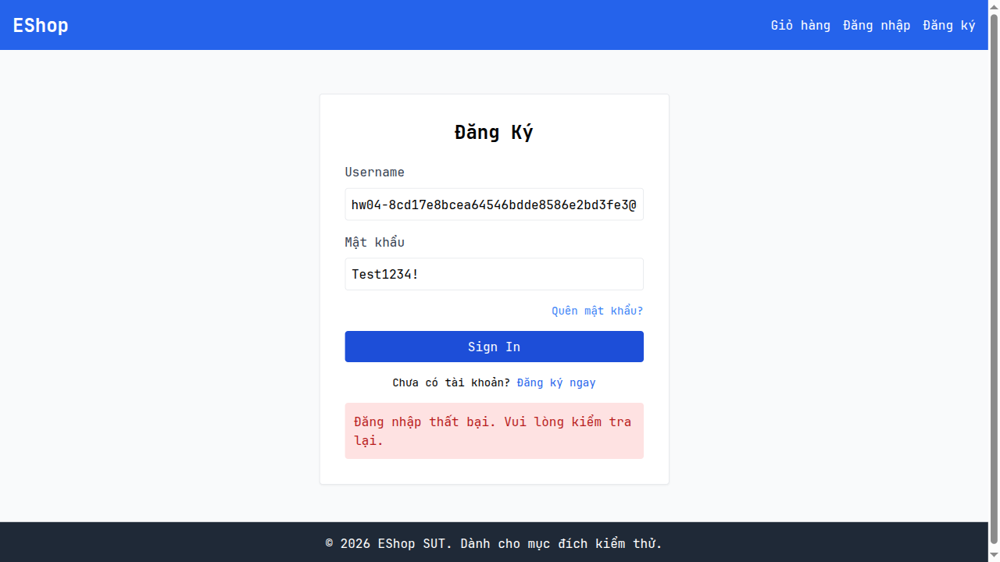


#### [BUG-03][FR-02] Login email field accepts malformed email

- Issue: [#3](https://github.com/quocthaiLN/HW04-SoftwareTesting/issues/3); Open; severity đề xuất: Minor.
- Cases: FR-02-TC06; fail trên cả ba engines, hai batch đã lưu.

**Bước tái hiện** (SUT đã chạy theo mục 3 của Main-Report.md):

1. Start SUT per mục 3 của Main-Report.md and open /login.
2. Enter abc in the email field and a non-empty test password.
3. Submit; inspect the field type and native validity.

**Expected:** Email field type=email; malformed email is blocked by HTML5 validation and no POST /api/login is sent.

**Actual:** Field type=text and validity.valid=true. The form allows submission rather than blocking malformed email.

Lệnh chạy lại (sẽ tạo execution mới, chưa chạy trong Session005):

```bash
npx playwright test tests/fr02-login.spec.js --project=chromium --grep "FR-02-TC06"
```

**Evidence:** The type=email assertion and native validity assertion fail. Screenshot provides UI context; inspect trace for network submission rather than inferring requests from the image. Xem lỗi assertion/attachments trong matrix nêu trên và HTML report Session003 tương ứng trong bảng Final evidence.

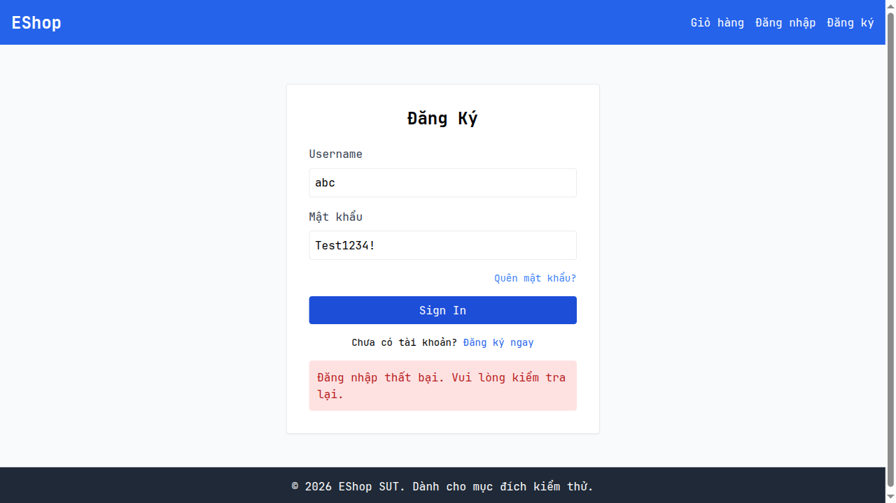


#### [BUG-04][FR-02] Password input displays typed password in plaintext

- Issue: [#4](https://github.com/quocthaiLN/HW04-SoftwareTesting/issues/4); Open; severity đề xuất: Major.
- Cases: FR-02-TC13; fail trên cả ba engines, hai batch đã lưu.

**Bước tái hiện** (SUT đã chạy theo mục 3 của Main-Report.md):

1. Start SUT per mục 3 của Main-Report.md and open /login.
2. Type the synthetic value TestMask123! into the password field.
3. Observe its rendering and input type.

**Expected:** type=password and masked glyphs conceal entered characters.

**Actual:** type=text; TestMask123! is plainly visible in the screenshot.

Lệnh chạy lại (sẽ tạo execution mới, chưa chạy trong Session005):

```bash
npx playwright test tests/fr02-login.spec.js --project=chromium --grep "FR-02-TC13"
```

**Evidence:** Only a synthetic test string is pictured; no real user password. Both screenshot and toHaveAttribute assertion establish the defect. Xem lỗi assertion/attachments trong matrix nêu trên và HTML report Session003 tương ứng trong bảng Final evidence.

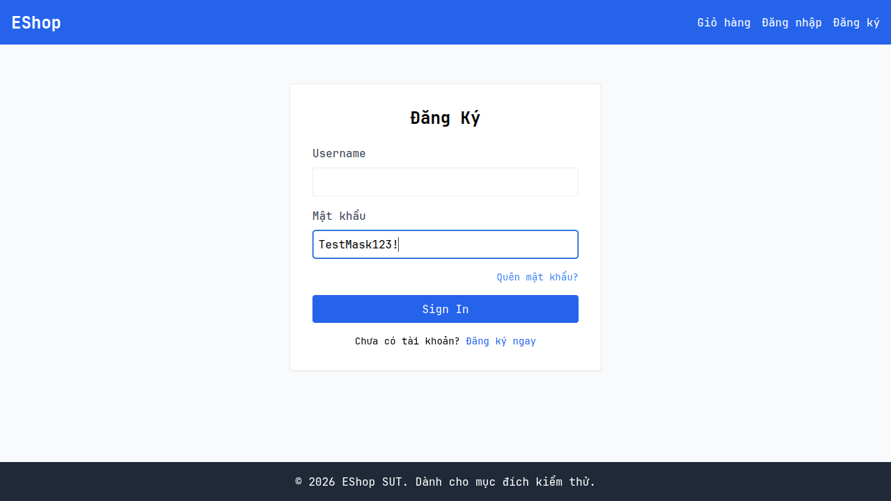


#### [BUG-05][FR-02] Login page displays registration heading

- Issue: [#5](https://github.com/quocthaiLN/HW04-SoftwareTesting/issues/5); Open; severity đề xuất: Minor.
- Cases: FR-02-TC14; fail trên cả ba engines, hai batch đã lưu.

**Bước tái hiện** (SUT đã chạy theo mục 3 của Main-Report.md):

1. Start SUT per mục 3 của Main-Report.md.
2. Open http://localhost:5173/login.
3. Observe the heading above the sign-in form.

**Expected:** Heading identifies the page as Đăng nhập.

**Actual:** Heading reads Đăng Ký although URL is /login and submit action is Sign In.

Lệnh chạy lại (sẽ tạo execution mới, chưa chạy trong Session005):

```bash
npx playwright test tests/fr02-login.spec.js --project=chromium --grep "FR-02-TC14"
```

**Evidence:** Screenshot directly shows the incorrect heading. Expected wording is in the student-approved scope/test-case design. Xem lỗi assertion/attachments trong matrix nêu trên và HTML report Session003 tương ứng trong bảng Final evidence.

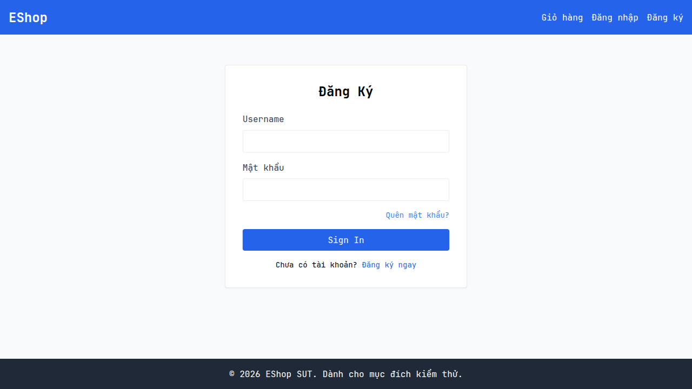


#### [BUG-06][FR-17] Duplicate coupon returns HTTP500 and exposes SQLite error

- Issue: [#6](https://github.com/quocthaiLN/HW04-SoftwareTesting/issues/6); Open; severity đề xuất: Major.
- Cases: FR-17-TC05; fail trên cả ba engines, hai batch đã lưu.

**Bước tái hiện** (SUT đã chạy theo mục 3 của Main-Report.md):

1. Start isolated SUT per mục 3 của Main-Report.md; create a test admin and authenticate.
2. Seed a unique coupon with defaults from data/shared.json.
3. Open admin Mã Giảm Giá at localhost:5174.
4. Create another coupon with exactly the same code and valid fields; capture response and alert.

**Expected:** HTTP400/409 and friendly duplicate-code message; original row remains once.

**Actual:** HTTP500; alert leaks SQLITE_CONSTRAINT / UNIQUE constraint failed: coupons.code.

Lệnh chạy lại (sẽ tạo execution mới, chưa chạy trong Session005):

```bash
npx playwright test tests/fr17-coupons.spec.js --project=chromium --grep "FR-17-TC05"
```

**Evidence:** Screenshot was captured after the alert was dismissed and shows the table, not the alert text. The runner error and trace provide the HTTP/dialog evidence. Do not infer error text from this screenshot. Xem lỗi assertion/attachments trong matrix nêu trên và HTML report Session003 tương ứng trong bảng Final evidence.

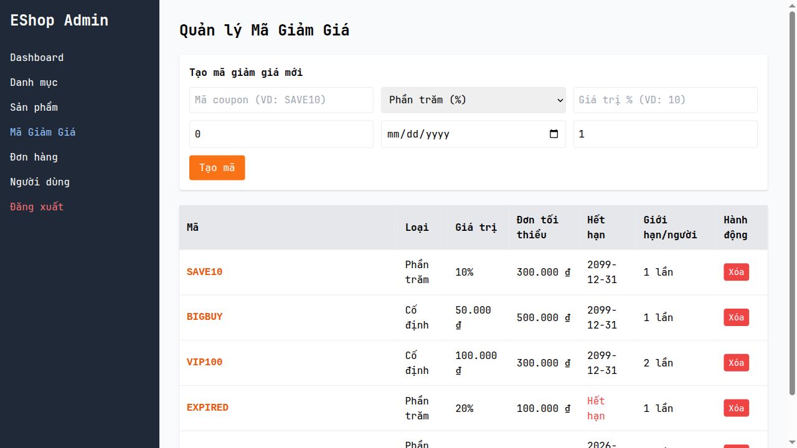


#### [BUG-07][FR-17] Percent coupons accept values outside integer range 1–100

- Issue: [#7](https://github.com/quocthaiLN/HW04-SoftwareTesting/issues/7); Open; severity đề xuất: Major.
- Cases: FR-17-TC08, FR-17-TC09, FR-17-TC32, FR-17-TC33, FR-17-TC34, FR-17-TC35; fail trên cả ba engines, hai batch đã lưu.

**Bước tái hiện** (SUT đã chạy theo mục 3 của Main-Report.md):

1. Start isolated SUT per mục 3 của Main-Report.md; authenticate a test admin and open Mã Giảm Giá.
2. Use a fresh code for each attempt; choose percent and valid expiry/min-order/use-limit defaults from data/shared.json.
3. Submit discount_value separately as 0, -1, 101, 120, 0.5, 1.5 (data/fr17.json).
4. Reload the table and inspect isolated SQLite read-only.

**Expected:** Reject each invalid value; percent must be an integer from 1 to 100; no new row persists.

**Actual:** All six invalid values return HTTP200 and persist after reload.

Lệnh chạy lại (sẽ tạo execution mới, chưa chạy trong Session005):

```bash
npx playwright test tests/fr17-coupons.spec.js --project=chromium --grep "FR-17-TC08|FR-17-TC09|FR-17-TC32|FR-17-TC33|FR-17-TC34|FR-17-TC35"
```

**Evidence:** Attached runner screenshot provides admin-page context; the offending row is below the captured viewport. HTTP200, persisted SQLite row and row count after reload are evidenced by runner assertions/trace for each case. Frontend validation is not bypassed. Xem lỗi assertion/attachments trong matrix nêu trên và HTML report Session003 tương ứng trong bảng Final evidence.


#### [BUG-08][FR-17] Fixed coupons accept zero and negative discount

- Issue: [#8](https://github.com/quocthaiLN/HW04-SoftwareTesting/issues/8); Open; severity đề xuất: Major.
- Cases: FR-17-TC24, FR-17-TC25; fail trên cả ba engines, hai batch đã lưu.

**Bước tái hiện** (SUT đã chạy theo mục 3 của Main-Report.md):

1. Start isolated SUT per mục 3 của Main-Report.md; authenticate a test admin and open Mã Giảm Giá.
2. Choose fixed; use a fresh code, min order 200000, future expiry and use limit 1.
3. Create separately with discount_value=0 and -50000.
4. Reload table and inspect isolated SQLite read-only.

**Expected:** Reject zero/negative fixed discounts; no row persists.

**Actual:** Both values return HTTP200 and persist after reload.

Lệnh chạy lại (sẽ tạo execution mới, chưa chạy trong Session005):

```bash
npx playwright test tests/fr17-coupons.spec.js --project=chromium --grep "FR-17-TC24|FR-17-TC25"
```

**Evidence:** Attached runner screenshot provides admin-page context; the created row is below the captured viewport. HTTP200 and persistence are evidenced by assertions/trace for TC24/TC25. Frontend validation is not bypassed. Xem lỗi assertion/attachments trong matrix nêu trên và HTML report Session003 tương ứng trong bảng Final evidence.

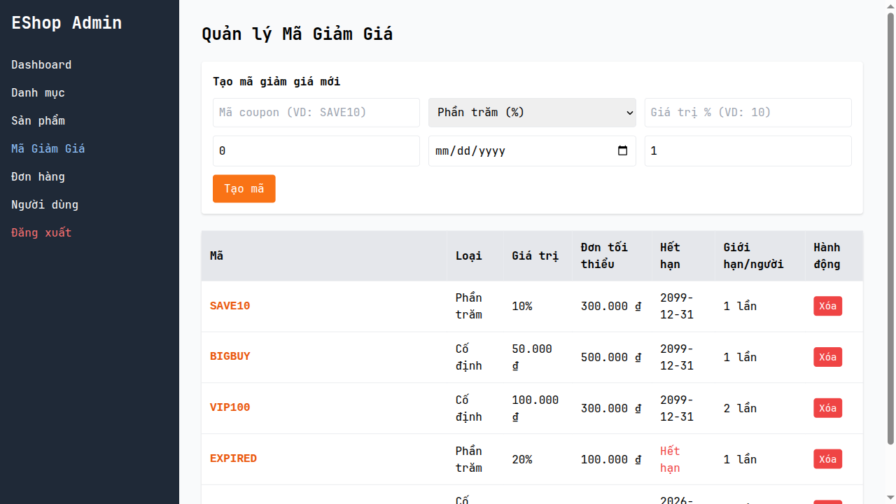


#### [BUG-09][FR-17] Coupon accepts negative minimum order amount

- Issue: [#9](https://github.com/quocthaiLN/HW04-SoftwareTesting/issues/9); Open; severity đề xuất: Major.
- Cases: FR-17-TC10; fail trên cả ba engines, hai batch đã lưu.

**Bước tái hiện** (SUT đã chạy theo mục 3 của Main-Report.md):

1. Start isolated SUT per mục 3 của Main-Report.md; authenticate a test admin and open Mã Giảm Giá.
2. Enter a fresh code, percent=10, min_order_amount=-1, future expiry and use limit 1.
3. Submit through the UI; reload table and inspect isolated SQLite read-only.

**Expected:** Reject negative minimum order amount; no coupon row persists.

**Actual:** HTTP200; coupon with min_order_amount=-1 persists after reload.

Lệnh chạy lại (sẽ tạo execution mới, chưa chạy trong Session005):

```bash
npx playwright test tests/fr17-coupons.spec.js --project=chromium --grep "FR-17-TC10"
```

**Evidence:** Attached runner screenshot provides admin-page context; the created row is below the captured viewport. HTTP200 and persisted negative minimum are evidenced by runner/trace and SQLite/row-count assertions. Frontend validation is not bypassed. Xem lỗi assertion/attachments trong matrix nêu trên và HTML report Session003 tương ứng trong bảng Final evidence.


### Kiểm tra phân loại REQ-12

- 9 defect groups: assertion đối chiếu expected đã duyệt, tái xuất hiện trên 3 engines ở hai batch; evidence có counter/deadline/type/status/SQLite/row-count tương ứng. Không kết luận chỉ từ timeout.
- Timeout FR-09-TC07/WebKit ở session003-full: execution issue chưa rõ nguyên nhân, không mở SUT defect Issue; final pass.
- Weak currency assertion và report attribution đã sửa ở Session003: lỗi test/report của AI, không tính vào defect SUT. Conditional Test Logic refactor ở Session004 là lỗi tổ chức test, không mở SUT Issue.
- Trong Session003–005, FR-09 chỉ UI mocked, không có defect backend được khẳng định ở các batch đó. Session006 bên dưới bổ sung3nhóm lỗi backend thật. Permission UI không chứng minh endpoint role enforcement.
- Ảnh BUG-06 không có alert đã đóng; BUG-07–09 chỉ thấy phần đầu trang, row cần kiểm tra ở ngoài viewport. Đã ghi giới hạn ngay trên Issue; dùng runner/trace làm evidence quyết định. Không chỉnh hay tạo ảnh SUT bằng AI.
- [Manifest cục bộ](artifacts/evidence/session005-bug-evidence.json) lưu mapping case/browser, Issue, attachment và SHA256 ảnh; các file local là nguồn evidence tự chứa, không phụ thuộc link online để mô tả bug.

### Migration evidence — Session005 cleanup

Theo yêu cầu sinh viên, artifact Session003 đã xóa; bộ runtime hiện hành là Session004. Các ảnh BUG-01–09 cục bộ được copy nguyên bản từ attachments Session004 (manifest ghi nguồn và SHA256). Ảnh trên GitHub Issues vẫn là ảnh đã upload trước cleanup; không thay thế lịch sử issue. Các nhắc Session003/batch cũ ở trên là ghi chép lịch sử, không phải evidence còn giữ.

### Session 006 — FR09 backend defects

The replacement suite uses real UI login → Home add → cart → checkout → apply coupon. No API/module mock, no edited checkout total and no final payment submission. Unique user/product/coupon/usage seeded in disposable SQLite; cleanup verified. 2026-11-16: Chromium/Firefox/WebKit each15pass/4fail; total45pass/12fail/0skip. These12failures represent3defect groups, not12bugs. The previous9groups remain historical, giving12known groups across the recorded batches; this is not a fresh full-suite run.

Source of expected: FR09 C3 >= minimum and percent/fixed formulas in eshop-sut/README.md; integer-VND floor and cap discount at total were approved by the student in testcase design (TC18/TC19). Severity below is proposed pending maintainer triage. Test code83bc1ae; evidence9cab75f. No SUT fixes or expected-value adjustments.

| Bug | Previous local ID | Cases | Suggested severity | GitHub |
| --- | --- | --- | --- | --- |
| BUG-10 | FR09-REAL-01 | FR-09-TC01, TC19 | High | [#10](https://github.com/quocthaiLN/HW04-SoftwareTesting/issues/10) — Open |
| BUG-11 | FR09-REAL-02 | FR-09-TC07 | Medium | [#11](https://github.com/quocthaiLN/HW04-SoftwareTesting/issues/11) — Open |
| BUG-12 | FR09-REAL-03 | FR-09-TC18 | High | [#12](https://github.com/quocthaiLN/HW04-SoftwareTesting/issues/12) — Open |

#### Shared reproduction and evidence

1. In submission/, start the isolated SUT with `npm run sut`.
2. Fixture coupon-real creates a unique real user/product/coupon and existing usage from data/fr09.json. Login through UI, add the product on Home, open cart and verify quantity1/amount.
3. Proceed to checkout through UI; enter the generated coupon and click Apply.
4. Inspect actual HTTP response in real-coupon-coverage attachment and the displayed amounts/error. Do not edit total or submit final payment.

Run one case with `PW_HEADLESS=true npm run test:fr09 -- --project=chromium --grep FR-09-TC07`; choose TC01/TC19/TC18 or another project as needed. Future runs create new evidence; this update reuses existing real run without rerunning tests.

[Matrix](artifacts/session006-fr09-real/execution-matrix.json), [Chromium report](artifacts/session006-fr09-real-chromium/html/index.html), [Firefox report](artifacts/session006-fr09-real-firefox/html/index.html), [WebKit report](artifacts/session006-fr09-real-webkit/html/index.html). Per-engine results.json retains real-response attachments. Screenshots below are byte-for-byte copies of Chromium runner outputs; source/hash mapping in artifacts/evidence/session006-bug-evidence.json. They show relevant UI directly; HTTP evidence comes from runner JSON, not inferred from screenshots.

#### BUG-10 — Percentage coupon increases payable amount

- Preconditions: active percent10coupon, min300000, expiry2099-12-31, maxUses1, uses0.
- TC01 cart500000: expected HTTP200 discount50000/final450000; actual HTTP200 discount-4500000/final5000000.
- TC19 cart333333: expected floored discount33333/final300000; actual HTTP200 discount-2999997/final3333330.
- UI displays the same incorrect values. Reproduced on all3engines. Impact: payable amount increases after applying a discount.
- Source inspection: backend/server.js uses `Math.floor(total_amount * (1 - coupon.discount_value))` in both branches.

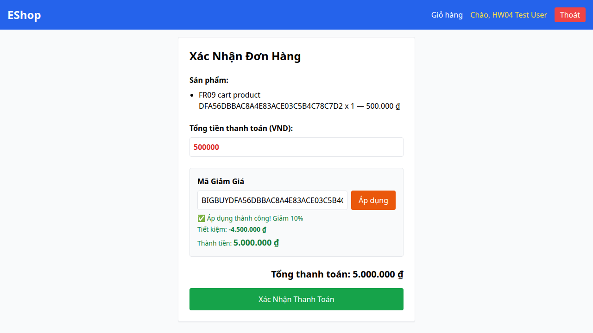

#### BUG-11 — Coupon rejects order exactly at minimum

- Preconditions: active fixed50000coupon, min300000, expiry2099-12-31, maxUses1, uses0; cart300000.
- Expected C3: total>=minimum, HTTP200 discount50000/final250000.
- Actual: HTTP400 error `Đơn hàng chưa đủ giá trị tối thiểu 300,000 ₫ để áp dụng mã này`; UI displays rejection and total300000.
- Reproduced on all3engines. Impact: eligible customers cannot apply coupon at advertised minimum. Source inspection: backend uses strict `>`.

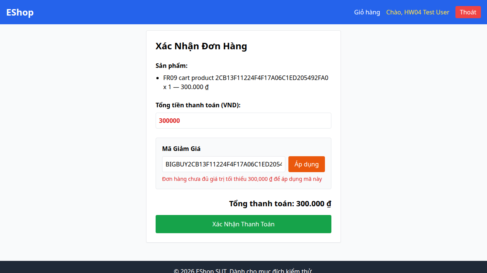

#### BUG-12 — Fixed discount exceeds total and produces negative payable

- Preconditions: active fixed100000coupon, min0, expiry2099-12-31, maxUses1, uses0; cart80000.
- Expected approved cap rule: HTTP200 discount80000/final0.
- Actual: HTTP200 discount100000/final-20000; UI displays negative final/payable. Reproduced on all3engines.
- Impact: invalid negative amount in checkout. Source inspection: backend subtracts full fixed discount without capping at total. No final payment was submitted, so downstream order/payment impact is not established.

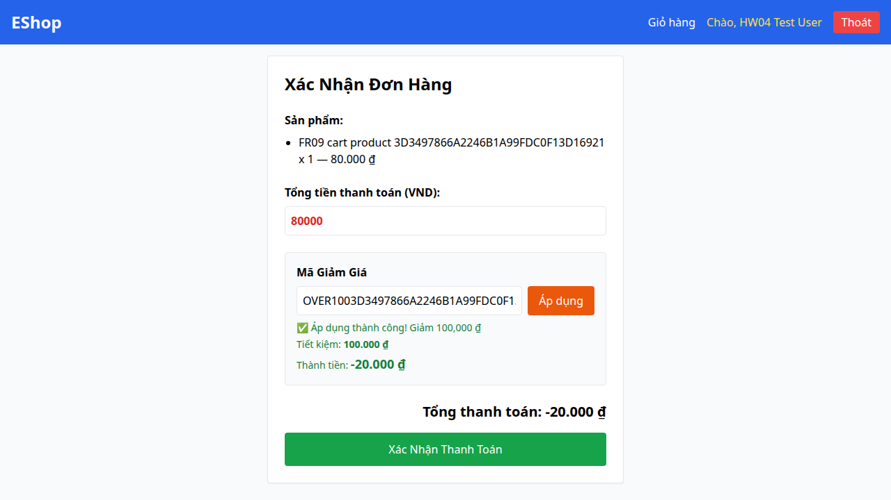

Publication verified 2026-11-16T10:23:36+07:00: Issues #10–#12 each show the expected body and uploaded runner image. [GitHub list confirmation](artifacts/evidence/session006-github-issues.png). [Screenshot source/hash/asset manifest](artifacts/evidence/session006-bug-evidence.json). Existing Issues #1–#9 were retained.

## 8. Demo Video (Task 2)

[Video demo do sinh viên cung cấp](https://youtu.be/-32746b5iEI?si=RqwYGPSNndiy2B_h). Sinh viên xác nhận ngày 16/11/2026 đã hoàn thành toàn bộ tiêu chí: unlisted, ≥5 phút, giọng Việt của chính sinh viên, face-cam hoặc cả terminal whoami và hostname, chạy script end-to-end gồm multi-browser/HTML report và giải thích ít nhất một sửa lỗi AI. Đây là xác nhận của sinh viên; lượt rà soát không tuyên bố AI đã xem/nghe video.

## 9. Agent Skill

Mục tiêu: hướng dẫn sinh/bảo trì scripts data-driven multi-browser có case-ID traceability. Bộ skill nguồn `testdino-hq/playwright-skill`; [lockfile](skills/skills-lock.json) lưu source/hash. Đây là bộ skill sử dụng, chưa tuyên bố là skill do sinh viên tự viết.

| Skill nhỏ | Thành phần thật | Luồng hoạt động và áp dụng |
| --- | --- | --- |
| [playwright-cli](skills/.agents/skills/playwright-cli/SKILL.md) | SKILL.md; core-commands, session-management, tracing-and-debugging, test-generation, request-mocking, storage-and-auth… | Mở named session → snapshot → tương tác → trace/screenshot → ghi nhận locator → đóng session. Dùng discovery; snapshot cũ đã xóa khi cleanup |
| [playwright-core](skills/.agents/skills/playwright-core/SKILL.md) | SKILL.md và guides locators, assertions-and-waiting, fixtures-and-hooks, configuration, test-data-management, clock/network/mock, debugging… | Chọn guide theo nhu cầu → đọc contract → viết locator/assertion/fixture/config → chạy → trace/debug → xác minh |
| [playwright-pom](skills/.agents/skills/playwright-pom/SKILL.md) | SKILL.md; page-object-model.md; pom-vs-fixtures-vs-helpers.md | Xác định UI thao tác lặp → gom LoginPage/CouponsPage → inject qua fixture → spec giữ business assertions; không đặt DB lifecycle trong POM |
| [playwright-qa](skills/.agents/skills/playwright-qa/SKILL.md) | SKILL.md; test-design, manual-to-automated, test-review, bug-reports | Acceptance criteria → EP/BVA/risk → case IDs → map spec/data → review → phân loại app/script/flake → bug report. Có trong bộ skill; không nhận toàn bộ QA workflow đã được chạy trong các phiên trước |

Các package chủ yếu chứa hướng dẫn/examples Markdown; không có template runner hay executable script hỗ trợ riêng được xác nhận ở cấp skill. Scripts của **bài làm** là scripts/validate-test-data.js, start-sut.js, run-matrix.js, verify-reports.js; không gọi chúng là bundled scripts của skill. Ví dụ mẫu cần chuyển input/expected sang JSON, không copy inline data trái REQ-07.

Luồng tổng: yêu cầu đã chốt → QA/cases → CLI/discovery → Core/config+fixtures → POM/UI → matrix → QA/review+bugs → human sign-off. Tiết kiệm lặp lại quy tắc locator/wait/data/lifecycle, giúp3feature có cấu trúc đồng đều. Hạn chế: skill không thay policy/human review và không đảm bảo không thiếu BVA; đường dẫn cross-guide trong bản package có thể dùng tên thư mục upstream khác. Ở giai đoạn đầu, FR-09 mock own API là ngoại lệ đã duyệt; bản hiện tại đã thay bằng backend thật; QA gợi ý test.fail cho known bug nhưng suite giữ fail thật để báo cáo bài tập, không đổi expected.

URL video tại mục 8; sinh viên xác nhận đã hoàn thành toàn bộ, bao gồm demo skill trên một feature hoàn chỉnh. Bộ skill có ghi nguồn upstream, không nhận là toàn bộ nội dung do sinh viên tự viết.

## 10. Git Commit Log


Có **11 commits chạm `.spec.js`** trong Git hiện tại: 9 commits triển khai ban đầu, 1 refactor và 1 chuyển FR09 sang backend thật. Docs-only commits không tính.

- `83bc1ae [REQ-03,06,07,08,09] Replace FR09 mocks with real cart UI and coupon backend tests`
- `3cd7cc6 [REQ-11] Separate test behaviors and retain homogeneous data-driven groups`
- `ecad404 [REQ-07,08] Strengthen exact currency assertions using external display oracles`
- `945cf44 [REQ-06,08] Verify coupon deletion and UI authorization without admin token`
- `cf436b6 [REQ-06,08] Exercise FR-17 form rejection, duplicate and numeric boundaries`
- `ffe21bb [REQ-06,08] Add coupon POM and FR-17 Create Read persistence checks`
- `661c1ae [REQ-06,08] Add FR-09 auth, error, empty and payload assertions`
- `ae36e9e [REQ-06,08] Cover FR-09 success, boundary, cap and rounding UI contracts`
- `3caf495 [REQ-06,08] Add real-time lockout, reset and JWT scenarios for FR-02`
- `622c221 [REQ-06,08] Automate FR-02 login and HTML validation with isolated users`
- `d995b45 [REQ-06,07,08] Prove FR-09 mocked cart and coupon UI using external JSON`


[git-log.txt](git-log.txt) xuất bằng `git log --graph --all --stat` từ Git thực tế, bỏ khoảng trắng cuối dòng để giữ định dạng sạch. Snapshot được xuất sau commit 3a18c52; commit chốt log/manifest/PDF theo sau không nằm trong chính snapshot của nó. Xem PROGRESS.md. Lịch sử thể hiện generation → assertion/data improvements → human refactor → evidence → report cleanup → FR09 backend thật.

## 11. Tự đánh giá (Self-Assessment)

**100/100 theo mức tự chấm sinh viên yêu cầu.** Đây là tự đánh giá, không là xác nhận mọi deliverable đã đủ: video/demo skill được sinh viên xác nhận hoàn thành qua URL đã cung cấp. Cần đối chiếu lại căn cứ trước nộp; không đổi trạng thái checklist thành DONE theo điểm tự chấm.

| Tiêu chí | Tối đa | Tự chấm | Căn cứ / phần còn thiếu |
| --- | ---: | ---: | --- |
| Feature A — FR-02 | 25 | 25 | 14cases/42executions,3engines;24fail liên quan5bug groups có evidence |
| Feature B — FR-09 | 25 | 25 | 19 cases/57 executions, 45 pass/12 fail; backend thật, 3 nhóm defect |
| Feature C — FR-17 | 25 | 25 | 35cases/105executions;30fail liên quan4bug groups có evidence |
| Video | 15 | 15 | Có URL; sinh viên xác nhận đủ tiêu chí video |
| Skill | 10 | 10 | Bộ 4 skills có nguồn, mô tả vai trò/flow; sinh viên xác nhận hoàn thành demo |
| **Tổng** | **100** | **100** | Mức tự chấm, không thay evidence còn thiếu |

Nếu giữ mức này khi đóng gói, mã3chữ số là `100`, tên dự kiến `23120352_HW04_AI_Automation_100.zip`. Bản ZIP được chuẩn bị ở thư mục gốc HW04; kiểm tra gói và checksum trước upload Moodle.

## 12. Kết luận & Hạn chế

Bộ test gồm 68 cases trên ba engines, dữ liệu JSON riêng và 12 nhóm lỗi được ghi nhận bằng runner/evidence thật. Evidence giữ lại tổng hợp hai phiên: 138 pass, 66 fail, không skip. FR-09 đã chuyển từ mock sang UI/backend thật; test dừng trước xác nhận thanh toán. UI permission/auth guards không thay cho kiểm thử trực tiếp endpoint security.

Human review Session004 đã chấp nhận refactor Conditional Test Logic và thiết kế bổ sung BVA. Trong lượt rà soát cuối ngày 16/11/2026, sinh viên xác nhận đã review cả FR09 backend thật và toàn bộ báo cáo, đồng thời hoàn thành video/demo. Repository Public đã được xác minh và bản cuối đã được push; sinh viên nộp Moodle đúng hạn theo link lớp. Không ghi nhận đã nộp Moodle khi chưa có thao tác nộp.

### Đối chiếu đề trước nộp

| Yêu cầu đề | Bằng chứng trong bài |
| --- | --- |
| 3 features A/B/C; ≥12 cases mỗi feature | FR02/09/17: 14/19/35 cases, mục 2 và 5 |
| Data ngoài CSV/JSON; ≥3 assertion patterns | data/, tests/, mục 3 |
| ≥9 browser runs; HTML có Run by và ISO | artifacts/execution-matrix.json; final-report-verification.json |
| Human review; lỗi AI và nguyên nhân | mục 6; xác nhận review cuối của sinh viên |
| Bugs trong Markdown + Issues kèm ảnh | mục 7; 12 groups; manifests và screenshot Issues cục bộ |
| Video ≥5 phút, giọng Việt, authorship, multi-browser/HTML, một fix AI | mục 8; sinh viên xác nhận đủ tiêu chí |
| Skill và demo | mục 9; skills/ có nguồn; sinh viên xác nhận demo |
| AI Audit/Critique Markdown + PDF | file kèm theo; Critique 274 từ theo cách đếm whitespace |
| ≥8 qualifying test-script commits; Git log text | 11 commits; git-log.txt |
| README summary/rubric, report PDF và ZIP đúng tên | README.md; các PDF và gói 23120352_HW04_AI_Automation_100.zip (4 phần split ZIP, mỗi phần <20MB) |

Sinh viên chịu trách nhiệm tính cá nhân, không sao chép prompts và nội dung, xác nhận sẵn sàng giải thích bài. Gợi ý tự kiểm tra khi oral defense 5–7 phút: giải thích JSON → fixture → POM → spec → assertions; vì sao mock cũ không chứng minh backend; cách tách Conditional Test Logic; một bug percent/min/cap với expected/actual; phân biệt 204 executions tổng hợp với một full-suite run.

## Appendix A — AI Audit Report

[AI-Report-Audit.md](AI-Report-Audit.md) ghi ngày giờ, prompt và output. [PROGRESS.md](PROGRESS.md) lưu tiến trình; [requirements-list.json](requirements-list.json) theo dõi nghiệm thu. Testcases tham khảo và các tình huống bổ sung **do sinh viên mô tả**, được chuẩn hóa trong [test-cases.json](test-cases.json) và data JSON.

## Appendix B — AI Critique

Nội dung do sinh viên cung cấp, giữ nguyên văn; bản riêng [AI-Critique.md](AI-Critique.md) được giữ để nộp theo yêu cầu.

Dù AI thể hiện năng lực vượt trội trong việc tự động hóa quá trình viết code và triển khai kịch bản kiểm thử, thực tế vận hành cho thấy mô hình vẫn tồn tại những khoảng trống nhất định về phạm vi phân tích và cấu trúc logic. Cụ thể, trong quá trình thực hiện, AI chưa tự động liệt kê đầy đủ các test case bao gồm kỹ thuật Phân tích Giá trị Biên (BVA) do thông tin này không được đề cập tường minh trong prompt ban đầu. Bên cạnh đó, các đoạn script automation sinh ra tuy hoạt động ổn định nhưng lại lạm dụng cấu trúc if-else chồng chéo, làm giảm tính minh bạch và tăng chi phí bảo trì mã nguồn.

Nguyên nhân dẫn đến sự bỏ sót này nằm ở việc AI phụ thuộc hoàn toàn vào dữ liệu đầu vào. Mô hình chỉ phản hồi đúng những gì được yêu cầu thay vì tự suy diễn toàn bộ các kịch bản kiểm thử nâng cao nếu thiếu đi sự định hướng chi tiết. Qua đó, nguyên tắc hợp tác tối ưu giữa con người và AI được đúc kết: AI chỉ đóng vai trò thực thi kỹ thuật, trong khi con người phải chịu trách nhiệm định hình chiến lược, kiểm soát kiến trúc và cung cấp ngữ cảnh chi tiết thông qua prompt hoặc skill có cấu trúc rõ ràng. Sự cộng hưởng này đòi hỏi con người phải chủ động chuẩn hóa yêu cầu đầu vào để hạn chế độ trễ logic và tối ưu hóa chất lượng mã nguồn do AI tạo ra.
