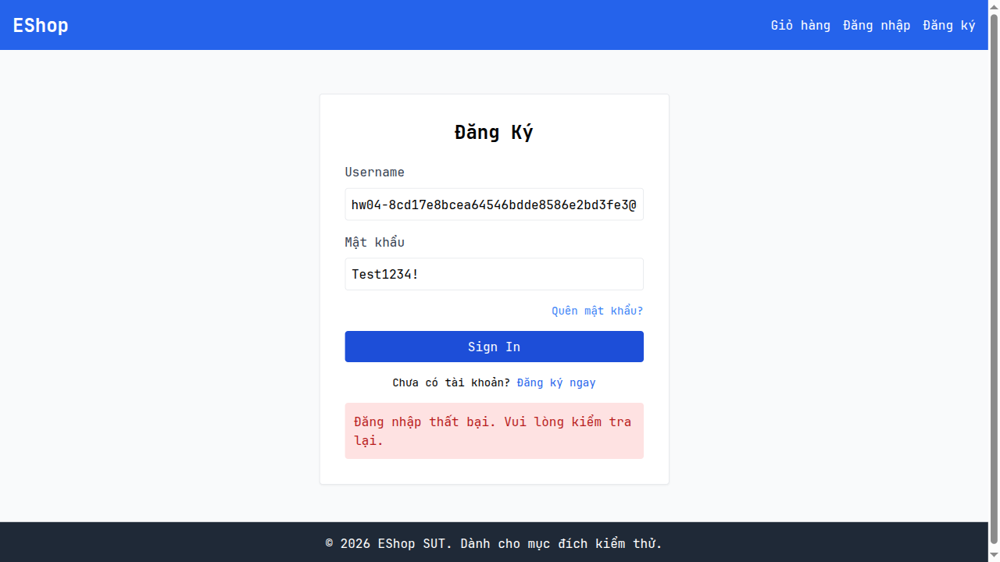
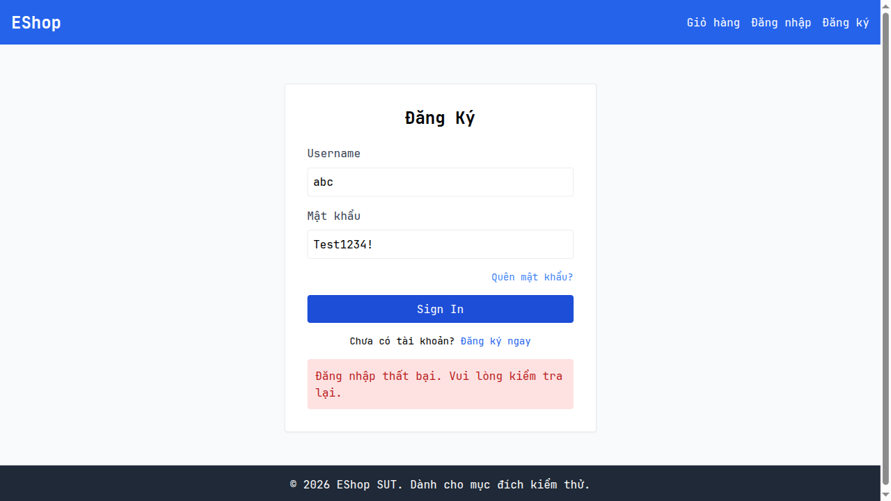
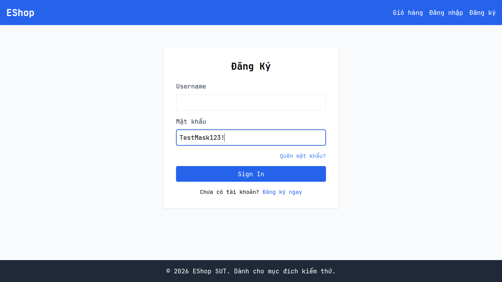
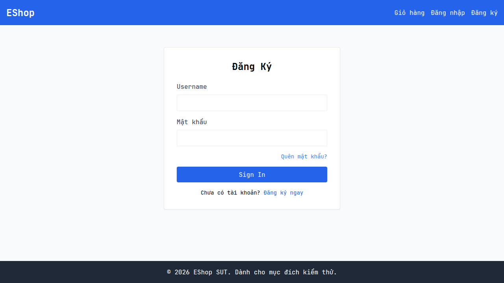
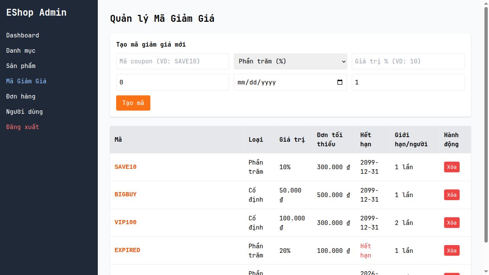
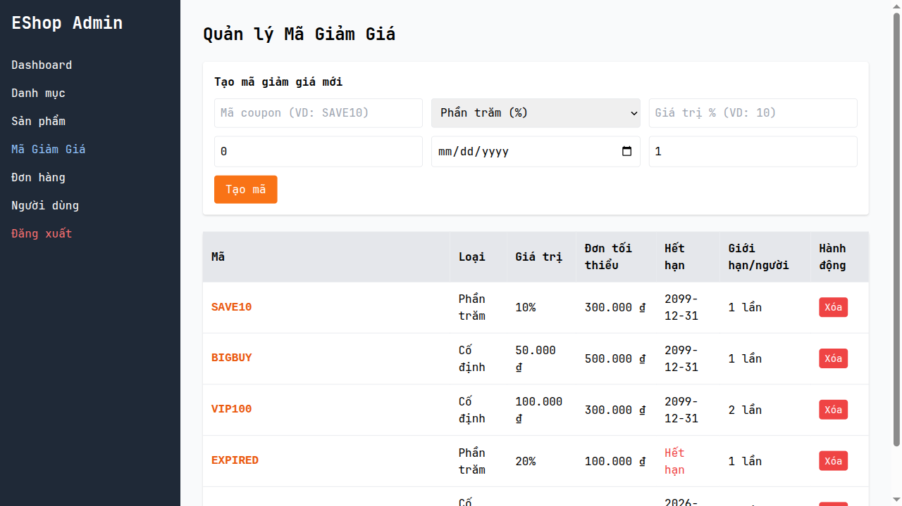
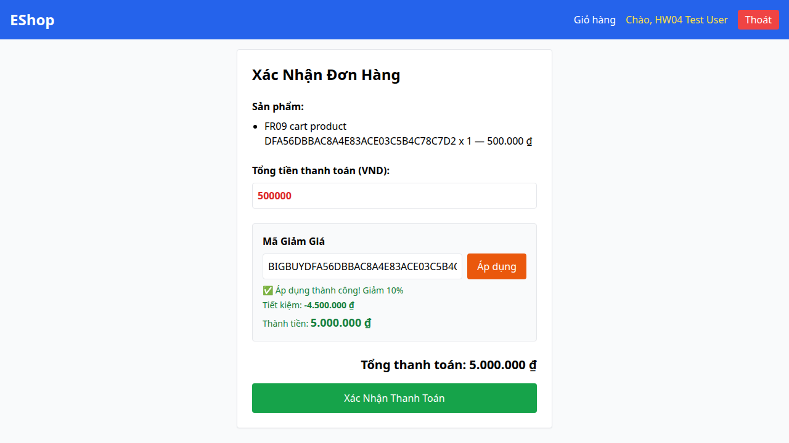
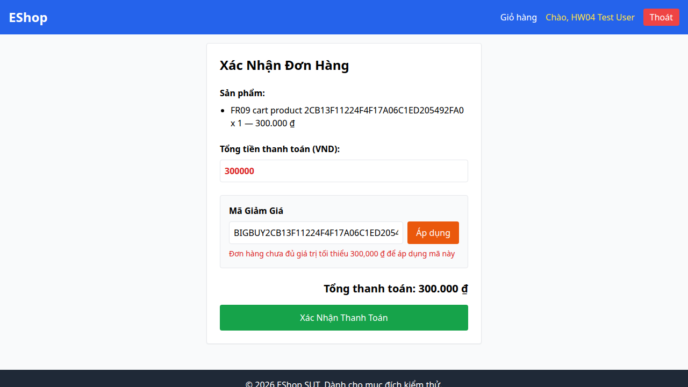
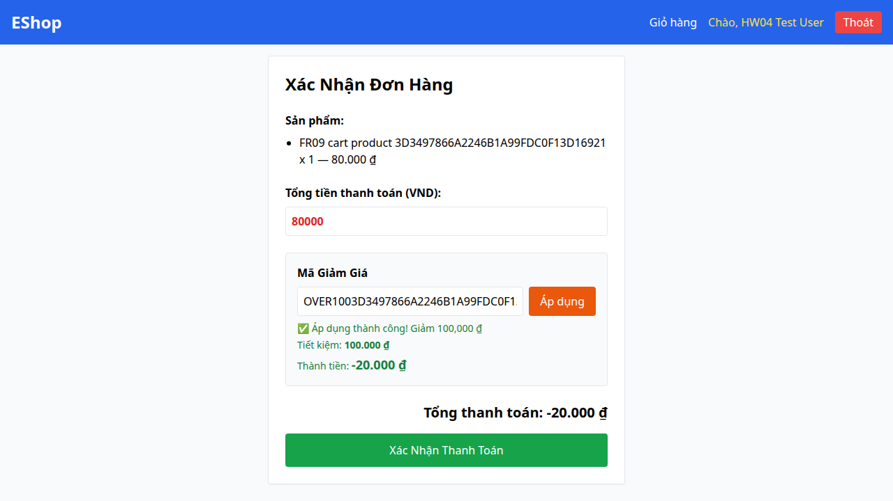

# Bug reports — Sessions 003–006

Historical findings từ Session003; GitHub Issues đã tạo và xác minh ở Session005 bên dưới; không mở rộng sang kiểm tra backend coupon apply hoặc endpoint role enforcement. Expected dựa scope/cases đã duyệt. Evidence paths cuối cùng sẽ được liên kết trong automation-report.md và artifacts/session004-refactor/execution-matrix.json. Các nhóm dưới đã xuất hiện ở cả Chromium/Firefox/WebKit trong batch đầu.

| ID | Case IDs | Expected | Actual runtime | Mức ảnh hưởng |
| --- | --- | --- | --- | --- |
| BUG-01 | FR-02-TC02, TC07 | Mỗi lần sai tăng 1; hai lần sai chưa khóa | DB counter=2 sau một lần sai; login đúng sau hai lần sai trả 403 | Khóa account sớm |
| BUG-02 | FR-02-TC08–TC10 | Khóa theo policy 30 giây; login đúng ở mốc 31 giây thành công | locked_until xấp xỉ 180 giây; sau 31 giây vẫn 403 | Thời gian khóa sai |
| BUG-03 | FR-02-TC06 | Email HTML5 chặn abc, không POST login | type=text, validity.valid=true, form gửi login | Validation email thiếu |
| BUG-04 | FR-02-TC13 | type=password và glyph che | type=text; screenshot thấy nguyên mật khẩu test | Lộ mật khẩu khi nhập |
| BUG-05 | FR-02-TC14 | Heading nhận diện Đăng nhập | Heading Đăng Ký | Nhận diện luồng sai |
| BUG-06 | FR-17-TC05 | Duplicate HTTP400/409, lỗi nghiệp vụ thân thiện | HTTP500; alert chứa SQLITE_CONSTRAINT/UNIQUE constraint failed: coupons.code | Lộ lỗi nội bộ và sai contract lỗi |
| BUG-07 | FR-17-TC08/09/32–35 | Percent nguyên trong 1–100 | Các giá trị 0/-1/101/120/0.5/1.5 nhận HTTP200 và lưu sau reload | Dữ liệu percent sai |
| BUG-08 | FR-17-TC24/25 | Fixed phải dương | Fixed 0/-50000 nhận HTTP200 và persist | Dữ liệu fixed sai |
| BUG-09 | FR-17-TC10 | Min order không âm | Min=-1 nhận HTTP200 và persist | Dữ liệu min order sai |

## Tái hiện chung

FR-02: start SUT cô lập theo RUNNING.md, tạo test account qua fixture từ data/shared.json, chạy case tương ứng bằng --grep và --project. Login qua UI; counters/deadline đọc SQLite riêng, không sửa deadline trong bước đo. TC10 thực sự đợi 31 giây, không page.clock.

FR-17: fixture tạo admin test và login setup API thật, mở admin app/tab Mã Giảm Giá; điền dữ liệu từ data/fr17.json với shared defaults. Case duplicate seed một code riêng rồi tạo lại qua UI; invalid cases không bypass HTML validation. Đối chiếu HTTP response, bảng sau reload và SQLite read-only assertions. Cleanup xóa coupon/account thuộc case sau khi thu kết quả.

## Phân loại riêng lỗi thực thi

Batch session003-full có FR-09-TC07/WebKit timeout tại actionability click (8 giây), trước request apply. Chưa có bằng chứng đây là lỗi SUT; không cộng vào 9 defect groups. Trong batch đó có mở browser khác để kiểm tra report khi WebKit đang chạy; mất foreground/animation scheduling là giả thuyết, chưa xác minh nguyên nhân. Batch final không mở thêm browser quan sát trong lúc tests chạy; kết quả cũ đã được xóa trong cleanup, lịch sử ghi trong Git/audit.

## Review AI đã sửa

Assertion tiền ban đầu dùng toContainText có thể nhận nhầm số dài hơn hoặc chuỗi có 0. Đã sửa toHaveText với prefixes/suffixes từ JSON và chạy lại suite. Custom metadata trong reporter 1.65 mặc định ẩn fields khác nếu không bật show-metadata-other; đã cấu hình title có attribution và ISO ngay từ runtime. Đây là self-review AI, không phải xác nhận human review của sinh viên.

## Final evidence

Batch session004-refactor: 150 pass/54 fail/0 skipped. FR-09 đạt57/57; timeout batch đầu không lặp lại, nguyên nhân gốc vẫn chưa kết luận.

| Bug | Case | Screenshot | Report |
| --- | --- | --- | --- |
| BUG-01 | FR-02-TC02 / Chromium | [Actual screenshot](artifacts/evidence/BUG-01.png) | [Actual report](artifacts/session004-refactor-fr02-chromium/html/index.html) |
| BUG-02 | FR-02-TC10 / Chromium | [Actual screenshot](artifacts/evidence/BUG-02.png) | [Actual report](artifacts/session004-refactor-fr02-chromium/html/index.html) |
| BUG-03 | FR-02-TC06 / Chromium | [Actual screenshot](artifacts/evidence/BUG-03.png) | [Actual report](artifacts/session004-refactor-fr02-chromium/html/index.html) |
| BUG-04 | FR-02-TC13 / Chromium | [Actual screenshot](artifacts/evidence/BUG-04.png) | [Actual report](artifacts/session004-refactor-fr02-chromium/html/index.html) |
| BUG-05 | FR-02-TC14 / Chromium | [Actual screenshot](artifacts/evidence/BUG-05.png) | [Actual report](artifacts/session004-refactor-fr02-chromium/html/index.html) |
| BUG-06 | FR-17-TC05 / Chromium | [Actual screenshot](artifacts/evidence/BUG-06.png) | [Actual report](artifacts/session004-refactor-fr17-chromium/html/index.html) |
| BUG-07 | FR-17-TC32 / Chromium | [Actual screenshot](artifacts/evidence/BUG-07.png) | [Actual report](artifacts/session004-refactor-fr17-chromium/html/index.html) |
| BUG-08 | FR-17-TC24 / Chromium | [Actual screenshot](artifacts/evidence/BUG-08.png) | [Actual report](artifacts/session004-refactor-fr17-chromium/html/index.html) |
| BUG-09 | FR-17-TC10 / Chromium | [Actual screenshot](artifacts/evidence/BUG-09.png) | [Actual report](artifacts/session004-refactor-fr17-chromium/html/index.html) |

Screenshot duplicate được chụp sau alert đã được đóng; xem dialog text/response trong lỗi runner và trace, không suy ra nội dung alert từ ảnh bảng. Các ảnh được copy từ output runner, không tạo/sửa hình.

## Session 005 — GitHub Issues và báo cáo chi tiết

Đối chiếu đề §6 p.4 và §14 p.7; hoàn tất REQ-12 lúc 2026-11-13T17:11:43+07:00. Đã tạo và mở kiểm tra từng Issue, mỗi Issue có một screenshot gốc từ runner. [Danh sách Issues](https://github.com/quocthaiLN/HW04-SoftwareTesting/issues); ảnh xác minh danh sách: [session005-github-issues.png](artifacts/evidence/session005-github-issues.png).

Các kết quả Session003/004 là evidence đã chạy, không phải lượt chạy mới. Playwright Test 1.65.0; Node v24.21.0; Linux; Chromium 158.0.8127.18 / Firefox 159.0 / WebKit 27.2 (artifacts/session004-refactor/execution-matrix.json). Test revision Session004: `3cd7cc68e83c3f3417b31a02a47231df5f3e54e0`. SUT nguyên trạng, backend/SQLite cô lập, ports API3000/web5173/admin5174. FR-02/17 không mock API. Setup và cleanup theo RUNNING.md; dữ liệu trong data/shared.json và data/fr02.json/data/fr17.json.

Policy integer percent 1–100, fixed>0 và min>=0 theo testcase design/scope đã được sinh viên chốt. Severity dưới đây là đề xuất của báo cáo, chưa phải đánh giá của maintainer. Status Open, chưa sửa SUT. 54 executions fail = 18 case IDs × 3 browsers; được gộp thành 9 defect groups, không báo thành 54 bugs.

| Bug | GitHub Issue | Cases |
| --- | --- | --- |
| BUG-01 | [#1](https://github.com/quocthaiLN/HW04-SoftwareTesting/issues/1) | FR-02-TC02, FR-02-TC07 |
| BUG-02 | [#2](https://github.com/quocthaiLN/HW04-SoftwareTesting/issues/2) | FR-02-TC08, FR-02-TC09, FR-02-TC10 |
| BUG-03 | [#3](https://github.com/quocthaiLN/HW04-SoftwareTesting/issues/3) | FR-02-TC06 |
| BUG-04 | [#4](https://github.com/quocthaiLN/HW04-SoftwareTesting/issues/4) | FR-02-TC13 |
| BUG-05 | [#5](https://github.com/quocthaiLN/HW04-SoftwareTesting/issues/5) | FR-02-TC14 |
| BUG-06 | [#6](https://github.com/quocthaiLN/HW04-SoftwareTesting/issues/6) | FR-17-TC05 |
| BUG-07 | [#7](https://github.com/quocthaiLN/HW04-SoftwareTesting/issues/7) | FR-17-TC08, FR-17-TC09, FR-17-TC32, FR-17-TC33, FR-17-TC34, FR-17-TC35 |
| BUG-08 | [#8](https://github.com/quocthaiLN/HW04-SoftwareTesting/issues/8) | FR-17-TC24, FR-17-TC25 |
| BUG-09 | [#9](https://github.com/quocthaiLN/HW04-SoftwareTesting/issues/9) | FR-17-TC10 |

### [BUG-01][FR-02] Failed login increments attempts twice and locks account early

- Issue: [#1](https://github.com/quocthaiLN/HW04-SoftwareTesting/issues/1); Open; severity đề xuất: Major.
- Cases: FR-02-TC02, FR-02-TC07; fail trên cả ba engines, hai batch đã lưu.

**Bước tái hiện** (SUT đã chạy theo RUNNING.md):

1. Start isolated SUT per RUNNING.md; create a fresh user (attempts=0, locked_until=null).
2. Open /login and submit one wrong password; read the isolated SQLite row.
3. On another fresh account, submit two wrong passwords then the correct password.

**Expected:** Increment exactly 1 per failed attempt; two failures still allow a correct login.

**Actual:** Counter=2 after one failure; correct password after two failures receives HTTP403.

Lệnh chạy lại (sẽ tạo execution mới, chưa chạy trong Session005):

```bash
npx playwright test tests/fr02-login.spec.js --project=chromium --grep "FR-02-TC02|FR-02-TC07"
```

**Evidence:** Screenshot shows the UI after failure. Counter and HTTP result are established by runner/trace, not the image alone. Xem lỗi assertion/attachments trong matrix nêu trên và HTML report Session003 tương ứng trong bảng Final evidence.


### [BUG-02][FR-02] Account remains locked after the required 30 seconds

- Issue: [#2](https://github.com/quocthaiLN/HW04-SoftwareTesting/issues/2); Open; severity đề xuất: Major.
- Cases: FR-02-TC08, FR-02-TC09, FR-02-TC10; fail trên cả ba engines, hai batch đã lưu.

**Bước tái hiện** (SUT đã chạy theo RUNNING.md):

1. Start isolated SUT per RUNNING.md; create a fresh account (attempts=0, locked_until=null).
2. Open /login and submit three wrong passwords.
3. Read locked_until from isolated SQLite without changing it.
4. Wait 31 real seconds after the third attempt, then submit the correct password.

**Expected:** Lock duration is 30 seconds; correct login succeeds at 31 seconds (HTTP200).

**Actual:** Deadline is approximately 180 seconds; correct login after 31 seconds returns HTTP403.

Lệnh chạy lại (sẽ tạo execution mới, chưa chạy trong Session005):

```bash
npx playwright test tests/fr02-login.spec.js --project=chromium --grep "FR-02-TC08|FR-02-TC09|FR-02-TC10"
```

**Evidence:** Screenshot shows rejected login; deadline and elapsed time are evidenced by lock-state-before attachment and runner/trace. Counter defect is tracked separately as BUG-01. Xem lỗi assertion/attachments trong matrix nêu trên và HTML report Session003 tương ứng trong bảng Final evidence.




### [BUG-03][FR-02] Login email field accepts malformed email

- Issue: [#3](https://github.com/quocthaiLN/HW04-SoftwareTesting/issues/3); Open; severity đề xuất: Minor.
- Cases: FR-02-TC06; fail trên cả ba engines, hai batch đã lưu.

**Bước tái hiện** (SUT đã chạy theo RUNNING.md):

1. Start SUT per RUNNING.md and open /login.
2. Enter abc in the email field and a non-empty test password.
3. Submit; inspect the field type and native validity.

**Expected:** Email field type=email; malformed email is blocked by HTML5 validation and no POST /api/login is sent.

**Actual:** Field type=text and validity.valid=true. The form allows submission rather than blocking malformed email.

Lệnh chạy lại (sẽ tạo execution mới, chưa chạy trong Session005):

```bash
npx playwright test tests/fr02-login.spec.js --project=chromium --grep "FR-02-TC06"
```

**Evidence:** The type=email assertion and native validity assertion fail. Screenshot provides UI context; inspect trace for network submission rather than inferring requests from the image. Xem lỗi assertion/attachments trong matrix nêu trên và HTML report Session003 tương ứng trong bảng Final evidence.




### [BUG-04][FR-02] Password input displays typed password in plaintext

- Issue: [#4](https://github.com/quocthaiLN/HW04-SoftwareTesting/issues/4); Open; severity đề xuất: Major.
- Cases: FR-02-TC13; fail trên cả ba engines, hai batch đã lưu.

**Bước tái hiện** (SUT đã chạy theo RUNNING.md):

1. Start SUT per RUNNING.md and open /login.
2. Type the synthetic value TestMask123! into the password field.
3. Observe its rendering and input type.

**Expected:** type=password and masked glyphs conceal entered characters.

**Actual:** type=text; TestMask123! is plainly visible in the screenshot.

Lệnh chạy lại (sẽ tạo execution mới, chưa chạy trong Session005):

```bash
npx playwright test tests/fr02-login.spec.js --project=chromium --grep "FR-02-TC13"
```

**Evidence:** Only a synthetic test string is pictured; no real user password. Both screenshot and toHaveAttribute assertion establish the defect. Xem lỗi assertion/attachments trong matrix nêu trên và HTML report Session003 tương ứng trong bảng Final evidence.




### [BUG-05][FR-02] Login page displays registration heading

- Issue: [#5](https://github.com/quocthaiLN/HW04-SoftwareTesting/issues/5); Open; severity đề xuất: Minor.
- Cases: FR-02-TC14; fail trên cả ba engines, hai batch đã lưu.

**Bước tái hiện** (SUT đã chạy theo RUNNING.md):

1. Start SUT per RUNNING.md.
2. Open http://localhost:5173/login.
3. Observe the heading above the sign-in form.

**Expected:** Heading identifies the page as Đăng nhập.

**Actual:** Heading reads Đăng Ký although URL is /login and submit action is Sign In.

Lệnh chạy lại (sẽ tạo execution mới, chưa chạy trong Session005):

```bash
npx playwright test tests/fr02-login.spec.js --project=chromium --grep "FR-02-TC14"
```

**Evidence:** Screenshot directly shows the incorrect heading. Expected wording is in the student-approved scope/test-case design. Xem lỗi assertion/attachments trong matrix nêu trên và HTML report Session003 tương ứng trong bảng Final evidence.




### [BUG-06][FR-17] Duplicate coupon returns HTTP500 and exposes SQLite error

- Issue: [#6](https://github.com/quocthaiLN/HW04-SoftwareTesting/issues/6); Open; severity đề xuất: Major.
- Cases: FR-17-TC05; fail trên cả ba engines, hai batch đã lưu.

**Bước tái hiện** (SUT đã chạy theo RUNNING.md):

1. Start isolated SUT per RUNNING.md; create a test admin and authenticate.
2. Seed a unique coupon with defaults from data/shared.json.
3. Open admin Mã Giảm Giá at localhost:5174.
4. Create another coupon with exactly the same code and valid fields; capture response and alert.

**Expected:** HTTP400/409 and friendly duplicate-code message; original row remains once.

**Actual:** HTTP500; alert leaks SQLITE_CONSTRAINT / UNIQUE constraint failed: coupons.code.

Lệnh chạy lại (sẽ tạo execution mới, chưa chạy trong Session005):

```bash
npx playwright test tests/fr17-coupons.spec.js --project=chromium --grep "FR-17-TC05"
```

**Evidence:** Screenshot was captured after the alert was dismissed and shows the table, not the alert text. The runner error and trace provide the HTTP/dialog evidence. Do not infer error text from this screenshot. Xem lỗi assertion/attachments trong matrix nêu trên và HTML report Session003 tương ứng trong bảng Final evidence.




### [BUG-07][FR-17] Percent coupons accept values outside integer range 1–100

- Issue: [#7](https://github.com/quocthaiLN/HW04-SoftwareTesting/issues/7); Open; severity đề xuất: Major.
- Cases: FR-17-TC08, FR-17-TC09, FR-17-TC32, FR-17-TC33, FR-17-TC34, FR-17-TC35; fail trên cả ba engines, hai batch đã lưu.

**Bước tái hiện** (SUT đã chạy theo RUNNING.md):

1. Start isolated SUT per RUNNING.md; authenticate a test admin and open Mã Giảm Giá.
2. Use a fresh code for each attempt; choose percent and valid expiry/min-order/use-limit defaults from data/shared.json.
3. Submit discount_value separately as 0, -1, 101, 120, 0.5, 1.5 (data/fr17.json).
4. Reload the table and inspect isolated SQLite read-only.

**Expected:** Reject each invalid value; percent must be an integer from 1 to 100; no new row persists.

**Actual:** All six invalid values return HTTP200 and persist after reload.

Lệnh chạy lại (sẽ tạo execution mới, chưa chạy trong Session005):

```bash
npx playwright test tests/fr17-coupons.spec.js --project=chromium --grep "FR-17-TC08|FR-17-TC09|FR-17-TC32|FR-17-TC33|FR-17-TC34|FR-17-TC35"
```

**Evidence:** Attached runner screenshot provides admin-page context; the offending row is below the captured viewport. HTTP200, persisted SQLite row and row count after reload are evidenced by runner assertions/trace for each case. Frontend validation is not bypassed. Xem lỗi assertion/attachments trong matrix nêu trên và HTML report Session003 tương ứng trong bảng Final evidence.


### [BUG-08][FR-17] Fixed coupons accept zero and negative discount

- Issue: [#8](https://github.com/quocthaiLN/HW04-SoftwareTesting/issues/8); Open; severity đề xuất: Major.
- Cases: FR-17-TC24, FR-17-TC25; fail trên cả ba engines, hai batch đã lưu.

**Bước tái hiện** (SUT đã chạy theo RUNNING.md):

1. Start isolated SUT per RUNNING.md; authenticate a test admin and open Mã Giảm Giá.
2. Choose fixed; use a fresh code, min order 200000, future expiry and use limit 1.
3. Create separately with discount_value=0 and -50000.
4. Reload table and inspect isolated SQLite read-only.

**Expected:** Reject zero/negative fixed discounts; no row persists.

**Actual:** Both values return HTTP200 and persist after reload.

Lệnh chạy lại (sẽ tạo execution mới, chưa chạy trong Session005):

```bash
npx playwright test tests/fr17-coupons.spec.js --project=chromium --grep "FR-17-TC24|FR-17-TC25"
```

**Evidence:** Attached runner screenshot provides admin-page context; the created row is below the captured viewport. HTTP200 and persistence are evidenced by assertions/trace for TC24/TC25. Frontend validation is not bypassed. Xem lỗi assertion/attachments trong matrix nêu trên và HTML report Session003 tương ứng trong bảng Final evidence.




### [BUG-09][FR-17] Coupon accepts negative minimum order amount

- Issue: [#9](https://github.com/quocthaiLN/HW04-SoftwareTesting/issues/9); Open; severity đề xuất: Major.
- Cases: FR-17-TC10; fail trên cả ba engines, hai batch đã lưu.

**Bước tái hiện** (SUT đã chạy theo RUNNING.md):

1. Start isolated SUT per RUNNING.md; authenticate a test admin and open Mã Giảm Giá.
2. Enter a fresh code, percent=10, min_order_amount=-1, future expiry and use limit 1.
3. Submit through the UI; reload table and inspect isolated SQLite read-only.

**Expected:** Reject negative minimum order amount; no coupon row persists.

**Actual:** HTTP200; coupon with min_order_amount=-1 persists after reload.

Lệnh chạy lại (sẽ tạo execution mới, chưa chạy trong Session005):

```bash
npx playwright test tests/fr17-coupons.spec.js --project=chromium --grep "FR-17-TC10"
```

**Evidence:** Attached runner screenshot provides admin-page context; the created row is below the captured viewport. HTTP200 and persisted negative minimum are evidenced by runner/trace and SQLite/row-count assertions. Frontend validation is not bypassed. Xem lỗi assertion/attachments trong matrix nêu trên và HTML report Session003 tương ứng trong bảng Final evidence.


## Kiểm tra phân loại REQ-12

- 9 defect groups: assertion đối chiếu expected đã duyệt, tái xuất hiện trên 3 engines ở hai batch; evidence có counter/deadline/type/status/SQLite/row-count tương ứng. Không kết luận chỉ từ timeout.
- Timeout FR-09-TC07/WebKit ở session003-full: execution issue chưa rõ nguyên nhân, không mở SUT defect Issue; final pass.
- Weak currency assertion và report attribution đã sửa ở Session003: lỗi test/report của AI, không tính vào defect SUT. Conditional Test Logic refactor ở Session004 là lỗi tổ chức test, không mở SUT Issue.
- Trong Session003–005, FR-09 chỉ UI mocked, không có defect backend được khẳng định ở các batch đó. Session006 bên dưới bổ sung3nhóm lỗi backend thật. Permission UI không chứng minh endpoint role enforcement.
- Ảnh BUG-06 không có alert đã đóng; BUG-07–09 chỉ thấy phần đầu trang, row cần kiểm tra ở ngoài viewport. Đã ghi giới hạn ngay trên Issue; dùng runner/trace làm evidence quyết định. Không chỉnh hay tạo ảnh SUT bằng AI.
- [Manifest cục bộ](artifacts/evidence/session005-bug-evidence.json) lưu mapping case/browser, Issue, attachment và SHA256 ảnh; các file local là nguồn evidence tự chứa, không phụ thuộc link online để mô tả bug.

## Migration evidence — Session005 cleanup

Theo yêu cầu sinh viên, artifact Session003 đã xóa; bộ runtime hiện hành là Session004. Các ảnh BUG-01–09 cục bộ được copy nguyên bản từ attachments Session004 (manifest ghi nguồn và SHA256). Ảnh trên GitHub Issues vẫn là ảnh đã upload trước cleanup; không thay thế lịch sử issue. Các nhắc Session003/batch cũ ở trên là ghi chép lịch sử, không phải evidence còn giữ.

## Session 006 — FR09 backend defects

The replacement suite uses real UI login → Home add → cart → checkout → apply coupon. No API/module mock, no edited checkout total and no final payment submission. Unique user/product/coupon/usage seeded in disposable SQLite; cleanup verified. 2026-11-16: Chromium/Firefox/WebKit each15pass/4fail; total45pass/12fail/0skip. These12failures represent3defect groups, not12bugs. The previous9groups remain historical, giving12known groups across the recorded batches; this is not a fresh full-suite run.

Source of expected: FR09 C3 >= minimum and percent/fixed formulas in eshop-sut/README.md; integer-VND floor and cap discount at total were approved by the student in testcase design (TC18/TC19). Severity below is proposed pending maintainer triage. Test code83bc1ae; evidence9cab75f. No SUT fixes or expected-value adjustments.

| Bug | Previous local ID | Cases | Suggested severity | GitHub |
| --- | --- | --- | --- | --- |
| BUG-10 | FR09-REAL-01 | FR-09-TC01, TC19 | High | [#10](https://github.com/quocthaiLN/HW04-SoftwareTesting/issues/10) — Open |
| BUG-11 | FR09-REAL-02 | FR-09-TC07 | Medium | [#11](https://github.com/quocthaiLN/HW04-SoftwareTesting/issues/11) — Open |
| BUG-12 | FR09-REAL-03 | FR-09-TC18 | High | [#12](https://github.com/quocthaiLN/HW04-SoftwareTesting/issues/12) — Open |

### Shared reproduction and evidence

1. In submission/, start the isolated SUT with `npm run sut`.
2. Fixture coupon-real creates a unique real user/product/coupon and existing usage from data/fr09.json. Login through UI, add the product on Home, open cart and verify quantity1/amount.
3. Proceed to checkout through UI; enter the generated coupon and click Apply.
4. Inspect actual HTTP response in real-coupon-coverage attachment and the displayed amounts/error. Do not edit total or submit final payment.

Run one case with `PW_HEADLESS=true npm run test:fr09 -- --project=chromium --grep FR-09-TC07`; choose TC01/TC19/TC18 or another project as needed. Future runs create new evidence; this update reuses existing real run without rerunning tests.

[Matrix](artifacts/session006-fr09-real/execution-matrix.json), [Chromium report](artifacts/session006-fr09-real-chromium/html/index.html), [Firefox report](artifacts/session006-fr09-real-firefox/html/index.html), [WebKit report](artifacts/session006-fr09-real-webkit/html/index.html). Per-engine results.json retains real-response attachments. Screenshots below are byte-for-byte copies of Chromium runner outputs; source/hash mapping in artifacts/evidence/session006-bug-evidence.json. They show relevant UI directly; HTTP evidence comes from runner JSON, not inferred from screenshots.

### BUG-10 — Percentage coupon increases payable amount

- Preconditions: active percent10coupon, min300000, expiry2099-12-31, maxUses1, uses0.
- TC01 cart500000: expected HTTP200 discount50000/final450000; actual HTTP200 discount-4500000/final5000000.
- TC19 cart333333: expected floored discount33333/final300000; actual HTTP200 discount-2999997/final3333330.
- UI displays the same incorrect values. Reproduced on all3engines. Impact: payable amount increases after applying a discount.
- Source inspection: backend/server.js uses `Math.floor(total_amount * (1 - coupon.discount_value))` in both branches.



### BUG-11 — Coupon rejects order exactly at minimum

- Preconditions: active fixed50000coupon, min300000, expiry2099-12-31, maxUses1, uses0; cart300000.
- Expected C3: total>=minimum, HTTP200 discount50000/final250000.
- Actual: HTTP400 error `Đơn hàng chưa đủ giá trị tối thiểu 300,000 ₫ để áp dụng mã này`; UI displays rejection and total300000.
- Reproduced on all3engines. Impact: eligible customers cannot apply coupon at advertised minimum. Source inspection: backend uses strict `>`.



### BUG-12 — Fixed discount exceeds total and produces negative payable

- Preconditions: active fixed100000coupon, min0, expiry2099-12-31, maxUses1, uses0; cart80000.
- Expected approved cap rule: HTTP200 discount80000/final0.
- Actual: HTTP200 discount100000/final-20000; UI displays negative final/payable. Reproduced on all3engines.
- Impact: invalid negative amount in checkout. Source inspection: backend subtracts full fixed discount without capping at total. No final payment was submitted, so downstream order/payment impact is not established.



Publication verified 2026-11-16T10:23:36+07:00: Issues #10–#12 each show the expected body and uploaded runner image. [GitHub list confirmation](artifacts/evidence/session006-github-issues.png). [Screenshot source/hash/asset manifest](artifacts/evidence/session006-bug-evidence.json). Existing Issues #1–#9 were retained.
