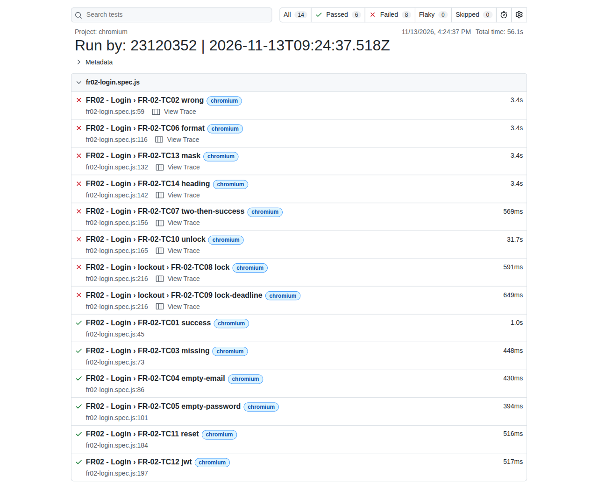
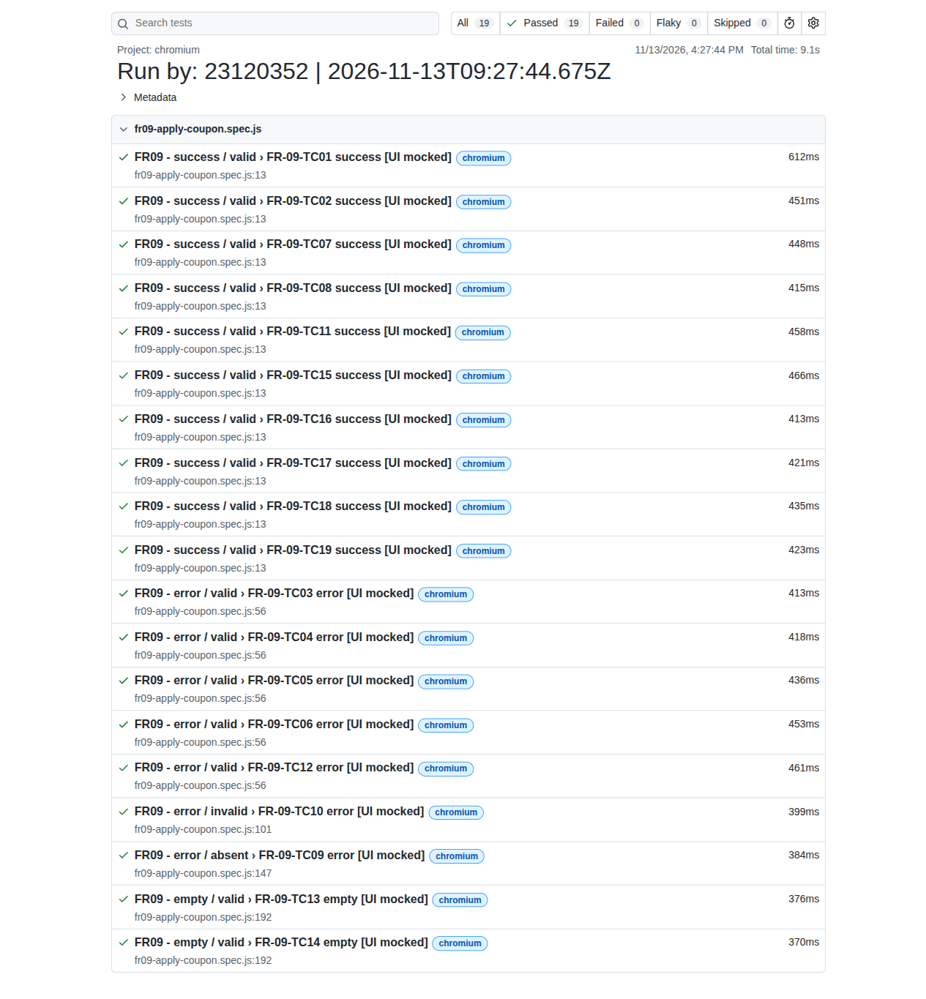
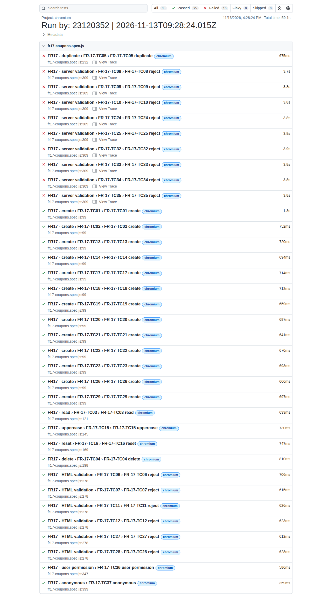
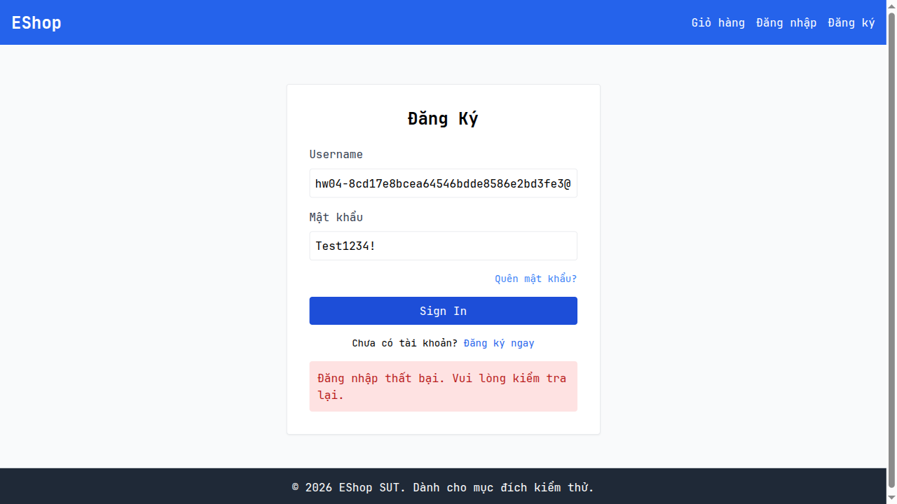
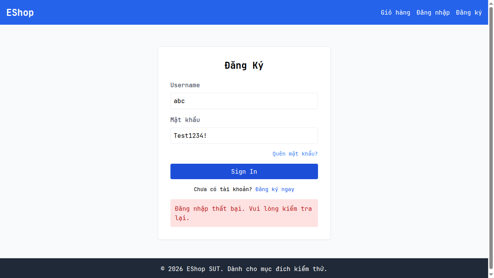
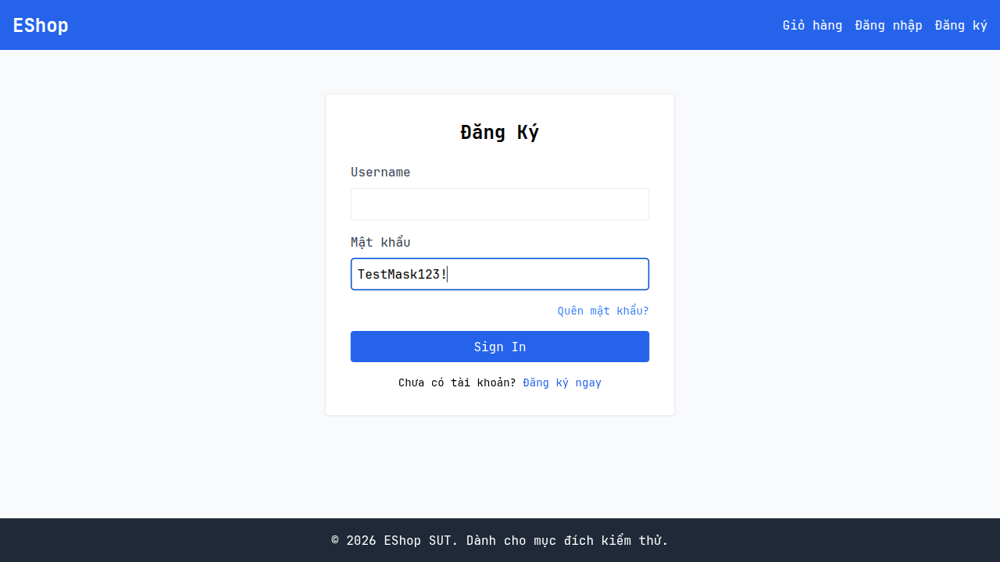
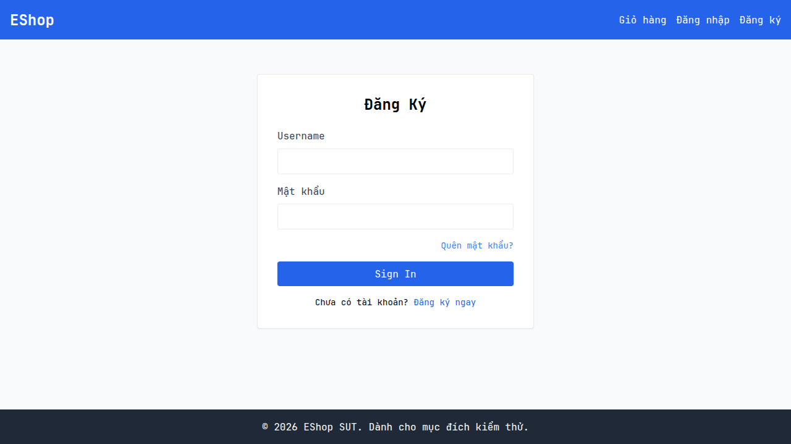
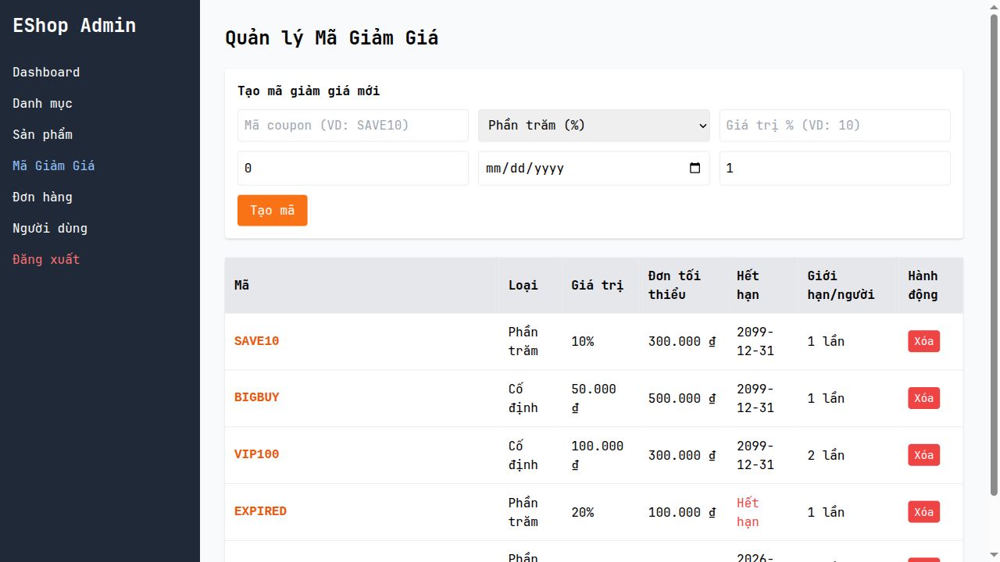
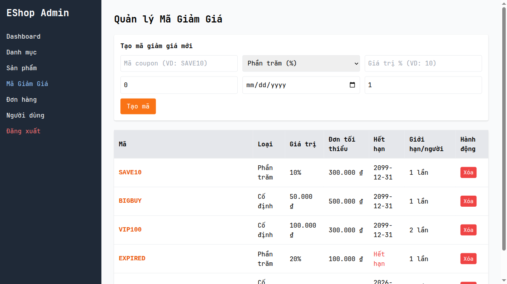
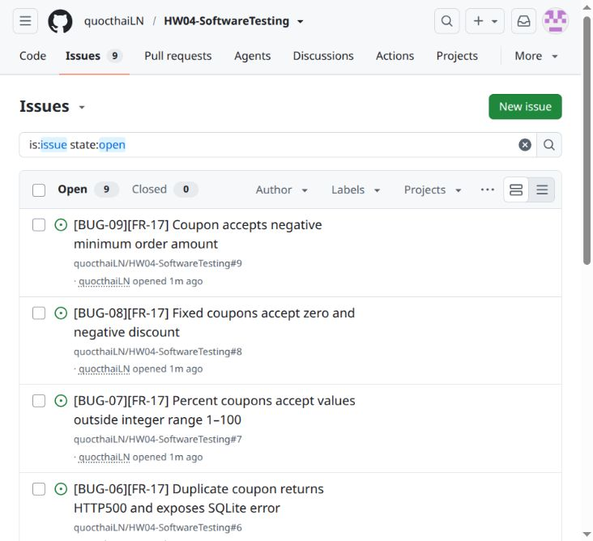

# HW04-AI — Automation Testing

## Trang bìa & Thông tin chung

| Thông tin | Nội dung |
| --- | --- |
| Họ tên | Lê Nguyễn Quốc Thái |
| MSSV | 23120352 |
| Môn học | Software Testing — Kiểm thử phần mềm |
| Mã bài tập | HW04-AI |
| Ngày nộp | Chưa nộp; ngày cập nhật báo cáo: 13/11/2026 |
| GitHub repository | [quocthaiLN/HW04-SoftwareTesting](https://github.com/quocthaiLN/HW04-SoftwareTesting); trạng thái public và độ đầy đủ nội dung xuất bản cần xác minh ở REQ-16 |
| YouTube unlisted | Thực hiện sau — chưa có URL |
| Playwright reports | 9 HTML reports tại mục 5; [execution matrix](artifacts/session004-refactor/execution-matrix.json) |

**AI declaration:** “I use AI tools for the following tasks: test automation planning, script generation and refactoring, execution analysis, bug documentation, and report drafting.” Công cụ: OpenAI Codex. Xem **Appendix A — AI Audit Report** ở cuối báo cáo; sinh viên chịu trách nhiệm review nội dung.

## 1. Tổng quan (Executive Summary)

Mục tiêu: tự động hóa kiểm thử UI cho EShop theo chiến lược AI-First, dữ liệu tách riêng, assertions rõ ràng và thực thi trên ba browser engines. SUT là EShop web/admin; backend được sao chép nguyên trạng vào runtime SQLite cô lập. FR-09 có ngoại lệ UI mock do sinh viên chốt; kết quả không xác minh backend coupon apply.

| Chỉ số | Giá trị |
| --- | ---: |
| Số feature | 3 |
| Test case tự động hóa | 68 (14 / 19 / 35) |
| Test case thực thi phân biệt | 68 |
| Case pass / fail trên cả ma trận | 50 pass cả 3 engines / 18 fail cả 3 engines |
| Lượt thực thi case × browser | 204 |
| Lượt pass / fail / skip | 150 / 54 / 0 |
| Browser run | 9 (3 features × 3 engines) |
| Bug phát hiện | 9 nhóm defect |
| Commit chạm file .spec.js | 10 |

Bộ evidence hiện hành: `session004-refactor`, test revision `3cd7cc68e83c3f3417b31a02a47231df5f3e54e0`, chạy từ 2026-11-13T09:24:37.173Z đến 2026-11-13T09:32:10.786Z. Số fail được giữ đúng kết quả thực tế; 54 lượt fail không được đếm thành 54 bugs.

## 2. Lựa chọn Feature

Sinh viên xác nhận Session001: ba features tương ứng HW02 và không trùng thành viên nhóm; không áp dụng trường hợp chưa có HW02.

| Pool | Feature | Lý do chọn | Phạm vi |
| --- | --- | --- | --- |
| A | FR-02 Login/lockout | Có state counter, JWT và biên thời gian | Login, input validation, khóa/mở khóa, reset, mask/heading |
| B | FR-09 Apply coupon | Có quyết định nghiệp vụ, payload và biên tiền | UI với auth/cart/apply response mock; không checkout/backend formula |
| C | FR-17 Coupon management | Kết hợp CRUD, validation và persistence | Create/Read/Delete, dữ liệu biên, quyền UI; không Update vì SUT không hỗ trợ |

[Scope](scope.md) và [test-cases.json](test-cases.json) chứa preconditions, steps, expected và traceability đầy đủ.

## 3. Môi trường & Kiến trúc Automation

| Thành phần | Sử dụng |
| --- | --- |
| Runner / ngôn ngữ | Playwright Test 1.65.0 / JavaScript CommonJS |
| CLI | @playwright/cli 0.1.24 |
| Runtime | Node.js v24.21.0; Linux; locale vi-VN; timezone Asia/Ho_Chi_Minh |
| Browsers (môi trường đã ghi nhận) | Chromium 158.0.8127.18; Firefox 159.0; WebKit 27.2 |
| Reporter | Playwright HTML + JSON + list |
| AI | OpenAI Codex; không suy đoán model version chưa được ghi nhận |
| Services | API :3000; web :5173; admin :5174; SQLite runtime cô lập |

Các browser versions nêu trên là môi trường được ghi nhận ở phiên chuẩn bị; preflight cũ đã xóa khi cleanup. Không coi đó là phép đo versions mới của Session004.

```text
submission/
├── tests/
│   ├── fr02-login.spec.js
│   ├── fr09-apply-coupon.spec.js
│   ├── fr17-coupons.spec.js
│   ├── pages/       # LoginPage, CouponsPage (không có pages/ ở root)
│   ├── fixtures/    # real-sut và coupon-routes
│   └── helpers/     # đọc JSON, resolve templates, format
├── data/            # shared.json, fr02.json, fr09.json, fr17.json
├── scripts/         # start-sut, validate, run-matrix, verify-reports
├── skills/.agents/skills/  # CLI / Core / POM / QA
├── artifacts/
│   ├── session004-refactor/  # matrix, summary, report-verification
│   ├── session004-refactor-<feature>-<browser>/
│   │   ├── html/            # reports thực tế (không có reports/ ở root)
│   │   └── results.json
│   └── evidence/            # ảnh bug và bằng chứng Issues
└── playwright.config.js
```

Luồng: JSON → validator → fixtures setup → thao tác UI/POM → assertions → runner HTML/JSON/trace → run-matrix tổng hợp → phân loại defect. POM chỉ thao tác UI; fixtures quản lý account/coupon/database cleanup. Mỗi test cô lập; workers=1, retries=0, chạy 9 tổ hợp tuần tự. Không sửa SUT hoặc expected để xanh test.

### Cấu hình multi-browser và attribution


```javascript
const startedAt = new Date().toISOString();
const artifactDir = path.resolve(__dirname, 'artifacts', runId);
module.exports = defineConfig({
  testDir: './tests', testMatch: '**/*.spec.js', fullyParallel: false,
  workers: 1, retries: 0, forbidOnly: true, timeout: 60000,
  expect: { timeout: 3000 },
  metadata: { 'Run by': '23120352', attribution: 'Run by: 23120352', timestamp: startedAt, runId, coverage: 'FR-09 UI mocked; FR-02/17 real isolated backend' },
  outputDir: path.join(artifactDir, 'test-results'),
  reporter: [['list'], ['html', { outputFolder: path.join(artifactDir, 'html'), open: 'never', title: `Run by: 23120352 | ${startedAt}` }], ['json', { outputFile: path.join(artifactDir, 'results.json') }]],
  use: { baseURL: process.env.WEB_URL || 'http://localhost:5173', headless: process.env.PW_HEADLESS === 'true', locale: 'vi-VN', timezoneId: 'Asia/Ho_Chi_Minh', serviceWorkers: 'block', trace: 'retain-on-failure', screenshot: 'only-on-failure', actionTimeout: 8000 },
  projects: [
    { name: 'chromium', use: { ...devices['Desktop Chrome'] } },
```

`projects` khai báo chromium/Firefox/WebKit với Desktop Chrome/Firefox/Safari; WebKit có thể dùng launcher local qua WEBKIT_EXECUTABLE_PATH. `startedAt = new Date().toISOString()` đưa vào title và metadata tại runtime; không sửa tay HTML. 9 reports Session004 đã được mở cục bộ, kiểm tra title Run by + ISO: [verification](artifacts/session004-refactor/report-verification.json).

### Data-driven và assertions

Toàn bộ input, setup, seed, mock response, expected và business timing nằm trong JSON ngoài. Giá trị động được resolve từ template/ngày offset; thiếu field phải báo lỗi, không fallback hardcode. Test chỉ lặp các records cùng hành vi. FR-09 mock response và expected riêng biệt không chứng minh phép tính backend.


Inventory của code đã triển khai, không phải kế hoạch. Các vị trí theo tên scenario/method để tra bằng rg; script references nằm trong tests/.

| Pattern | Case thực sự dùng | Script / method | Oracle ngoài code |
| --- | --- | --- | --- |
| Text, exact | FR-02-TC02/03 lỗi chung; FR-09 success/error amounts; FR-17 Create/Read fields | fr02-login.spec.js wrong/missing; pages/coupons.js assertRow | shared.expected.error; fr09.expected và shared.ui display prefixes/suffixes; fr17 records + shared defaults/typeLabels |
| Attribute/value | FR-02-TC06 email; TC13 password; FR-17-TC15 uppercase/TC16 reset | fr02-login.spec.js format/mask; fr17-coupons.spec.js uppercase/reset | shared.expected.emailType/passwordType; shared.maskPassword; shared.resetExpected |
| URL | FR-02-TC01/07/10/11/12 login thành công, TC14 login page | fr02-login.spec.js success/lockout/heading | Route là contract kỹ thuật của app; test inputs trong JSON |
| State/count | FR-09-TC13/14 disabled/no request; FR-17-TC04 Delete, TC36/37 access | fr09-apply-coupon.spec.js empty; fr17-coupons.spec.js delete/permissions | fr09.expected.applyCount/checkoutCount; fr17.expected.rowCount; shared.expected.zero |
| Polling DB state | FR-02-TC02 mỗi lần sai +1, TC11 reset | fr02-login.spec.js wrong/reset | shared.expected.one/zero, shared.null |
| Network/payload equality | FR-09-TC15/16 normalization, FR-02-TC12 Bearer JWT, FR-17-TC05 duplicate status | fr09-apply-coupon.spec.js; fr02-login.spec.js jwt; fr17-coupons.spec.js duplicate | JSON expected.code/total/user_id; login result token; shared.duplicateStatuses |
| Time/date policy | FR-02-TC08/09 duration, TC10 unlock; FR-17 expiry | fr02-login.spec.js lock/lock-deadline/unlock; pages/coupons.js assertRow | shared.expected.lockSeconds/unlockWaitMs; JSON expiry offsets/past date |

Giá trị kỳ vọng đọc từ JSON, không lấy từ UI vừa đọc để làm chính oracle cho UI. So sánh JWT với token cấp sau login chỉ là kiểm tra propagation, không chứng minh JWT cryptographic validity. FR-09 mock response và expected được khai báo riêng trong JSON; không coi đây là kiểm chứng công thức backend.

Không đếm nhiều lần cùng matcher là nhiều patterns. Soft assertions chỉ dùng để thu thêm bằng chứng liên quan trong cùng case; mọi soft failure vẫn làm case failed.


### Cách chạy lại

```bash
cd submission
npm ci
npx playwright install chromium firefox webkit
npm run validate
# Terminal riêng:
npm run sut
# Terminal chạy tests, SUT đã sẵn sàng:
PW_BATCH_ID=my-new-batch npm run matrix
# Hoặc một feature/browser:
PW_RUN_ID=my-login-run npx playwright test tests/fr02-login.spec.js --project=chromium
```

Xem [RUNNING.md](RUNNING.md) về ports, ownership, WebKit dependencies và dừng server. Dùng batch ID mới để bảo tồn evidence. TC10 đợi 31 giây thật cho policy mở khóa; đây là business deadline ngoài JSON, không phải sleep chờ UI tùy ý.

## 4. Quy trình AI-First

Áp dụng bộ skill Playwright theo vai trò: CLI quan sát UI → QA đối chiếu cases đã duyệt → Core viết assertions/fixtures/config → POM gom thao tác UI lặp lại → chạy matrix → QA phân loại fail/review → sinh viên chốt. Chi tiết từng thành phần ở mục 9.

1. Sinh viên xác nhận scope, thiết kế testcase và bổ sung BVA trước automation; AI không tự chốt policy còn mơ hồ.
2. CLI snapshot trước thao tác, dùng named session; không đưa snapshot refs vào spec lâu dài.
3. AI tạo theo từng nhóm feature/case, dữ liệu JSON ngoài; không yêu cầu một prompt sinh toàn bộ suite.
4. Core/POM chuẩn hóa fixtures, web-first assertions, locators và cleanup; validator đối chiếu stable case IDs.
5. Chạy ba engines, giữ fail thật; đọc report/trace/DB để phân biệt defect, script issue và environment issue.
6. Sinh viên review; AI sửa Conditional Test Logic, chạy batch Session004; sinh viên chấp nhận refactor và review còn lại. Lịch sử tương tác: Appendix A.

Ngoại lệ đã duyệt: mock own API cho FR-09 trái khuyến nghị mặc định của CLI/Core; giữ giới hạn UI mocked. Suite dùng retries=0 và trace retain-on-failure để giữ lỗi ngay lần đầu; không sao chép mặc định retry/trace của skill một cách máy móc.

## 5. Kết quả Automation theo từng Feature

### 5.1. Feature A — FR-02

#### 5.1.1 Mô tả feature

Login hợp lệ tạo token; mỗi lần sai tăng đúng 1; khóa sau 3 lần sai liên tiếp trong 30 giây, login đúng ở giây31 phải thành công; thành công reset counter. Email HTML5, password mask và heading được kiểm tra.

#### 5.1.2 Danh sách test case tự động hóa

Loại positive/negative/edge là phân loại báo cáo theo mục tiêu chính của case. Status dưới đây ghi số lượt P/F/S trên ba engines.

| ID | Loại | Mô tả | File data | Assertion pattern | P/F/S |
| --- | --- | --- | --- | --- | --- |
| FR-02-TC01 | positive | Login hợp lệ | data/fr02.json | toBe(status), toHaveURL, toBeVisible | 3/0/0 |
| FR-02-TC02 | negative | Sai mật khẩu | data/fr02.json | toContain(status), toBeVisible, expect.poll | 0/3/0 |
| FR-02-TC03 | negative | Email không tồn tại | data/fr02.json | toContain(status), toBeVisible | 3/0/0 |
| FR-02-TC04 | edge | Email trống | data/fr02.json | toBeFalsy(validity), toHaveLength | 3/0/0 |
| FR-02-TC05 | edge | Password trống | data/fr02.json | toBeFalsy(validity), toHaveLength | 3/0/0 |
| FR-02-TC06 | negative | Email sai format | data/fr02.json | toHaveAttribute, toBeFalsy | 0/3/0 |
| FR-02-TC07 | edge | Hai lần sai chưa khóa | data/fr02.json | toBe(status), toHaveURL | 0/3/0 |
| FR-02-TC08 | edge | Đủ ba lần sai bị khóa | data/fr02.json | toBe(deadline), toBeVisible | 0/3/0 |
| FR-02-TC09 | edge | Vẫn khóa trước 30 giây | data/fr02.json | toBe(deadline), toBeVisible | 0/3/0 |
| FR-02-TC10 | edge | Hết khóa sau 30 giây | data/fr02.json | toBe(status), toHaveURL | 0/3/0 |
| FR-02-TC11 | positive | Thành công reset attempts | data/fr02.json | expect.poll, toEqual | 3/0/0 |
| FR-02-TC12 | positive | JWT gửi request xác thực | data/fr02.json | toBe(Authorization), toBeVisible | 3/0/0 |
| FR-02-TC13 | positive | Mật khẩu được che bằng dấu chấm | data/fr02.json | toHaveValue, toHaveAttribute | 0/3/0 |
| FR-02-TC14 | positive | Giao diện nhận diện đúng trang Đăng nhập | data/fr02.json | toHaveURL, toBeVisible | 0/3/0 |

#### 5.1.3 Test data

[data/fr02.json](data/fr02.json) là mảng records; ID ánh xạ testcase. FR-02 records chứa id/scenario/feature; input và policy đọc từ data/shared.json.

```json
{
  "id": "FR-02-TC01",
  "scenario": "success",
  "feature": "FR-02"
}
```


#### 5.1.4 Script sau khi sửa

[tests/fr02-login.spec.js](tests/fr02-login.spec.js); đoạn trích nguyên bản hiện tại:

```javascript
test(title('success'), async ({
    page,
    db,
    testUser,
    login
  }) => {
    const response = await login.login(testUser.email, testUser.password);
    expect(response.status()).toBe(shared.expected.successStatus);
    await expect(page).toHaveURL('/');
    await expect(page.getByRole('link', {
      name: new RegExp(testUser.name)
    })).toBeVisible();
    expect(await page.evaluate(key => !!localStorage.getItem(key), shared.expected.tokenKey)).toBeTruthy();
  });
  test(title('wrong'), async ({
    page,
    db,
    testUser,
    login
  }) => {
    const response = await login.login(testUser.email, shared.wrongPassword);
    expect(shared.expected.failureStatus).toContain(response.status());
    await expect(page.getByText(shared.expected.error, {
      exact: true
    })).toBeVisible();
    expect(await page.evaluate(key => localStorage.getItem(key), shared.expected.tokenKey)).toBe(shared.null);
    await expect.poll(async () => (await db.get('SELECT login_attempts FROM users WHERE id=?', [testUser.id])).login_attempts).toBe(shared.expected.one);
```


#### 5.1.5 Kết quả thực thi

| Browser | Pass | Fail | Skip | HTML report |
| --- | ---: | ---: | ---: | --- |
| chromium | 6 | 8 | 0 | [HTML](artifacts/session004-refactor-fr02-chromium/html/index.html) |
| firefox | 6 | 8 | 0 | [HTML](artifacts/session004-refactor-fr02-firefox/html/index.html) |
| webkit | 6 | 8 | 0 | [HTML](artifacts/session004-refactor-fr02-webkit/html/index.html) |

Ảnh report Chromium có Run by và ISO; Firefox/WebKit đã được kiểm tra trong report-verification.json, ảnh tương ứng nằm trong từng run.



#### 5.1.6 Test case không automate được

Không có case nào trong14case đã duyệt bị bỏ automation. JWT chỉ kiểm tra lưu/truyền token, không xác minh chữ ký mật mã.

#### 5.1.7 Bug tìm thấy

| Bug | Cases | Issue có screenshot |
| --- | --- | --- |
| BUG-01 | FR-02-TC02, FR-02-TC07 | [#1](https://github.com/quocthaiLN/HW04-SoftwareTesting/issues/1) |
| BUG-02 | FR-02-TC08, FR-02-TC09, FR-02-TC10 | [#2](https://github.com/quocthaiLN/HW04-SoftwareTesting/issues/2) |
| BUG-03 | FR-02-TC06 | [#3](https://github.com/quocthaiLN/HW04-SoftwareTesting/issues/3) |
| BUG-04 | FR-02-TC13 | [#4](https://github.com/quocthaiLN/HW04-SoftwareTesting/issues/4) |
| BUG-05 | FR-02-TC14 | [#5](https://github.com/quocthaiLN/HW04-SoftwareTesting/issues/5) |

Chi tiết expected/actual và ảnh cục bộ tại mục7 và [bug-reports.md](bug-reports.md).

### 5.2. Feature B — FR-09

#### 5.2.1 Mô tả feature

Áp coupon qua UI; kiểm tra success/error/auth, điều kiện ngưỡng/lượt dùng, uppercase/trim payload, cap discount bằng total, final>=0 và floor phần trăm. Tất cả API auth/cart/apply được mock theo phạm vi đã chốt.

#### 5.2.2 Danh sách test case tự động hóa

Loại positive/negative/edge là phân loại báo cáo theo mục tiêu chính của case. Status dưới đây ghi số lượt P/F/S trên ba engines.

| ID | Loại | Mô tả | File data | Assertion pattern | P/F/S |
| --- | --- | --- | --- | --- | --- |
| FR-09-TC01 | positive | Percent hợp lệ | data/fr09.json | toHaveText, toEqual(payload), toHaveLength | 3/0/0 |
| FR-09-TC02 | positive | Fixed hợp lệ | data/fr09.json | toHaveText, toEqual(payload), toHaveLength | 3/0/0 |
| FR-09-TC03 | negative | Không tồn tại | data/fr09.json | toHaveText, toEqual(payload), toHaveLength | 3/0/0 |
| FR-09-TC04 | negative | Inactive | data/fr09.json | toHaveText, toEqual(payload), toHaveLength | 3/0/0 |
| FR-09-TC05 | negative | Hết hạn | data/fr09.json | toHaveText, toEqual(payload), toHaveLength | 3/0/0 |
| FR-09-TC06 | edge | Dưới ngưỡng 1 đồng | data/fr09.json | toHaveText, toEqual(payload), toHaveLength | 3/0/0 |
| FR-09-TC07 | edge | Đúng ngưỡng | data/fr09.json | toHaveText, toEqual(payload), toHaveLength | 3/0/0 |
| FR-09-TC08 | edge | Trên ngưỡng 1 đồng | data/fr09.json | toHaveText, toEqual(payload), toHaveLength | 3/0/0 |
| FR-09-TC09 | negative | Chưa đăng nhập | data/fr09.json | toHaveURL / toBeVisible, toHaveLength | 3/0/0 |
| FR-09-TC10 | negative | JWT không hợp lệ | data/fr09.json | toHaveURL / toBeVisible, toHaveLength | 3/0/0 |
| FR-09-TC11 | edge | Còn một lượt | data/fr09.json | toHaveText, toEqual(payload), toHaveLength | 3/0/0 |
| FR-09-TC12 | edge | Hết lượt | data/fr09.json | toHaveText, toEqual(payload), toHaveLength | 3/0/0 |
| FR-09-TC13 | edge | Mã coupon trống | data/fr09.json | toBeDisabled, toHaveLength | 3/0/0 |
| FR-09-TC14 | edge | Mã chỉ chứa khoảng trắng | data/fr09.json | toBeDisabled, toHaveLength | 3/0/0 |
| FR-09-TC15 | positive | Chuẩn hóa mã chữ thường trong request | data/fr09.json | toHaveText, toEqual(payload), toHaveLength | 3/0/0 |
| FR-09-TC16 | positive | Trim khoảng trắng đầu/cuối trong request | data/fr09.json | toHaveText, toEqual(payload), toHaveLength | 3/0/0 |
| FR-09-TC17 | edge | Giảm đúng bằng tổng đơn hàng | data/fr09.json | toHaveText, toEqual(payload), toHaveLength | 3/0/0 |
| FR-09-TC18 | edge | Tiền sau áp dụng không âm khi giảm vượt tổng | data/fr09.json | toHaveText, toEqual(payload), toHaveLength | 3/0/0 |
| FR-09-TC19 | edge | Làm tròn xuống tiền giảm phần trăm có phần lẻ | data/fr09.json | toHaveText, toEqual(payload), toHaveLength | 3/0/0 |

#### 5.2.3 Test data

[data/fr09.json](data/fr09.json) là mảng records; ID ánh xạ testcase. FR-09 records chứa input/authMode/user/cart/response/expected/policy; response là mock, expected là oracle UI.

```json
{
  "id": "FR-09-TC01",
  "feature": "FR-09",
  "scenario": "success",
  "input": {
    "code": "BIGBUY",
    "total": 500000
  },
  "authMode": "valid",
  "token": "mock-valid-token",
  "invalidToken": "mock-invalid-token",
  "user": {
    "id": 77,
    "name": "Mock Coupon User",
    "role": "user"
  },
  "cart": [
    {
      "id": 88,
      "name": "Mock cart item",
      "price": 500000,
      "quantity": 1
    }
  ],
  "response": {
    "status": 200,
    "body": {
      "coupon_id": 99,
      "discount_amount": 50000,
      "final_amount": 450000,
      "message": "Áp dụng thành công!"
    }
  },
  "expected": {
    "code": "BIGBUY",
    "total": 500000,
    "user_id": 77,
    "discount": 50000,
    "final": 450000,
    "error": null,
    "applyCount": 1,
    "checkoutCount": 0,
    "authStatus": 200
  },
  "policy": {
    "kind": "percent",
    "value": 10,
    "min": 300000,
    "uses": 0,
    "maxUses": 1,
    "active": true,
    "expiry": "2099-12-31"
  }
}
```


#### 5.2.4 Script sau khi sửa

[tests/fr09-apply-coupon.spec.js](tests/fr09-apply-coupon.spec.js); đoạn trích nguyên bản hiện tại:

```javascript
for (const record of records.filter(r => r.scenario === 'success' && r.authMode === 'valid')) {
    test(`${record.id} ${record.scenario} [UI mocked]`, async ({
      page,
      couponFixture
    }) => {
      await couponFixture.install(record);
      await page.goto('/checkout');
      await expect(page.getByRole('listitem')).toContainText(record.cart.map(item => item.name));
      await expect(page.getByRole('spinbutton')).toHaveValue(String(record.input.total));
      await expect(page.getByRole('link', {
        name: new RegExp(record.user.name)
      })).toBeVisible();
      const input = page.getByPlaceholder('Nhập mã giảm giá...');
      const apply = page.getByRole('button', {
        name: 'Áp dụng',
        exact: true
      });
      await input.fill(record.input.code);
      await apply.click();
      await expect(page.getByText('Tiết kiệm:')).toHaveText(shared.ui.savingsPrefix + money(record.expected.discount) + shared.ui.currencySuffix);
      await expect(page.getByText('Thành tiền:')).toHaveText(shared.ui.finalPrefix + money(record.expected.final) + shared.ui.currencySuffix);
      await expect(page.getByText('Tổng thanh toán:')).toHaveText(shared.ui.totalPrefix + money(record.expected.final) + shared.ui.currencySuffix);
      expect(couponFixture.calls.apply.map(call => call.body)).toEqual([{
        code: record.expected.code,
        total_amount: record.expected.total,
        user_id: record.expected.user_id
      }]);
      expect(couponFixture.calls.apply[shared.expected.zero].authorization).toBe(`Bearer ${record.token}`);
      expect(couponFixture.calls.apply).toHaveLength(record.expected.applyCount);
      expect(couponFixture.calls.checkout).toHaveLength(record.expected.checkoutCount);
      await test.info().attach('coverage', {
        body: JSON.stringify({
```


#### 5.2.5 Kết quả thực thi

| Browser | Pass | Fail | Skip | HTML report |
| --- | ---: | ---: | ---: | --- |
| chromium | 19 | 0 | 0 | [HTML](artifacts/session004-refactor-fr09-chromium/html/index.html) |
| firefox | 19 | 0 | 0 | [HTML](artifacts/session004-refactor-fr09-firefox/html/index.html) |
| webkit | 19 | 0 | 0 | [HTML](artifacts/session004-refactor-fr09-webkit/html/index.html) |

Ảnh report Chromium có Run by và ISO; Firefox/WebKit đã được kiểm tra trong report-verification.json, ảnh tương ứng nằm trong từng run.



#### 5.2.6 Test case không automate được

19/19case đã automate. Backend C1–C5/công thức và checkout không automate trong scope này; mock chỉ chứng minh UI/payload.

#### 5.2.7 Bug tìm thấy

Không phát hiện bug trong19cases UI mocked đã chạy; không suy thành backend không có lỗi.


Chi tiết expected/actual và ảnh cục bộ tại mục7 và [bug-reports.md](bug-reports.md).

### 5.3. Feature C — FR-17

#### 5.3.1 Mô tả feature

Admin Create/Read/Delete coupon; percent nguyên1–100, fixed>0, minimum>=0; code/expiry/value bắt buộc; lượt dùng>=1 nguyên; duplicate trả400/409 + lỗi thân thiện; quyền user/anonymous qua UI.

#### 5.3.2 Danh sách test case tự động hóa

Loại positive/negative/edge là phân loại báo cáo theo mục tiêu chính của case. Status dưới đây ghi số lượt P/F/S trên ba engines.

| ID | Loại | Mô tả | File data | Assertion pattern | P/F/S |
| --- | --- | --- | --- | --- | --- |
| FR-17-TC01 | positive | Create percent | data/fr17.json | toHaveText / toHaveValue / toHaveCount; status/DB theo scenario | 3/0/0 |
| FR-17-TC02 | positive | Create fixed | data/fr17.json | toHaveText / toHaveValue / toHaveCount; status/DB theo scenario | 3/0/0 |
| FR-17-TC03 | positive | Read fields | data/fr17.json | toHaveText / toHaveValue / toHaveCount; status/DB theo scenario | 3/0/0 |
| FR-17-TC04 | positive | Delete | data/fr17.json | toHaveText / toHaveValue / toHaveCount; status/DB theo scenario | 3/0/0 |
| FR-17-TC05 | negative | Duplicate code | data/fr17.json | toHaveText / toHaveValue / toHaveCount; status/DB theo scenario | 0/3/0 |
| FR-17-TC06 | negative | Code bắt buộc | data/fr17.json | toBeFalsy(validity), toHaveLength | 3/0/0 |
| FR-17-TC07 | negative | Value bắt buộc | data/fr17.json | toBeFalsy(validity), toHaveLength | 3/0/0 |
| FR-17-TC08 | edge | Value bằng 0 | data/fr17.json | toContain(status), toHaveLength(DB), toHaveCount | 0/3/0 |
| FR-17-TC09 | edge | Value âm | data/fr17.json | toContain(status), toHaveLength(DB), toHaveCount | 0/3/0 |
| FR-17-TC10 | edge | Min order âm | data/fr17.json | toContain(status), toHaveLength(DB), toHaveCount | 0/3/0 |
| FR-17-TC11 | edge | Expiry bắt buộc | data/fr17.json | toBeFalsy(validity), toHaveLength | 3/0/0 |
| FR-17-TC12 | edge | Uses dưới 1 | data/fr17.json | toBeFalsy(validity), toHaveLength | 3/0/0 |
| FR-17-TC13 | positive | Create fixed với đơn tối thiểu 0 | data/fr17.json | toHaveText / toHaveValue / toHaveCount; status/DB theo scenario | 3/0/0 |
| FR-17-TC14 | positive | Create ngày quá khứ và nhãn Hết hạn | data/fr17.json | toHaveText / toHaveValue / toHaveCount; status/DB theo scenario | 3/0/0 |
| FR-17-TC15 | positive | Uppercase mã khi nhập trên admin | data/fr17.json | toHaveText / toHaveValue / toHaveCount; status/DB theo scenario | 3/0/0 |
| FR-17-TC16 | positive | Reset form sau khi tạo thành công | data/fr17.json | toHaveText / toHaveValue / toHaveCount; status/DB theo scenario | 3/0/0 |
| FR-17-TC17 | edge | Biên percent hợp lệ: 1% | data/fr17.json | toHaveText / toHaveValue / toHaveCount; status/DB theo scenario | 3/0/0 |
| FR-17-TC18 | edge | Biên percent hợp lệ: 2% | data/fr17.json | toHaveText / toHaveValue / toHaveCount; status/DB theo scenario | 3/0/0 |
| FR-17-TC19 | edge | Biên percent hợp lệ: 50% | data/fr17.json | toHaveText / toHaveValue / toHaveCount; status/DB theo scenario | 3/0/0 |
| FR-17-TC20 | edge | Biên percent hợp lệ: 99% | data/fr17.json | toHaveText / toHaveValue / toHaveCount; status/DB theo scenario | 3/0/0 |
| FR-17-TC21 | edge | Biên percent hợp lệ: 100% | data/fr17.json | toHaveText / toHaveValue / toHaveCount; status/DB theo scenario | 3/0/0 |
| FR-17-TC22 | edge | Biên fixed dương: 1 đồng | data/fr17.json | toHaveText / toHaveValue / toHaveCount; status/DB theo scenario | 3/0/0 |
| FR-17-TC23 | edge | Biên fixed dương: 2 đồng | data/fr17.json | toHaveText / toHaveValue / toHaveCount; status/DB theo scenario | 3/0/0 |
| FR-17-TC24 | edge | Fixed không dương: 0 | data/fr17.json | toContain(status), toHaveLength(DB), toHaveCount | 0/3/0 |
| FR-17-TC25 | edge | Fixed không dương: -50000 | data/fr17.json | toContain(status), toHaveLength(DB), toHaveCount | 0/3/0 |
| FR-17-TC26 | edge | Đơn tối thiểu sát biên hợp lệ: 1 đồng | data/fr17.json | toHaveText / toHaveValue / toHaveCount; status/DB theo scenario | 3/0/0 |
| FR-17-TC27 | edge | Lượt dùng âm | data/fr17.json | toBeFalsy(validity), toHaveLength | 3/0/0 |
| FR-17-TC28 | edge | Lượt dùng thập phân qua UI | data/fr17.json | toBeFalsy(validity), toHaveLength | 3/0/0 |
| FR-17-TC29 | positive | Lượt dùng danh định: 10 | data/fr17.json | toHaveText / toHaveValue / toHaveCount; status/DB theo scenario | 3/0/0 |
| FR-17-TC32 | edge | Percent không hợp lệ: 101 | data/fr17.json | toContain(status), toHaveLength(DB), toHaveCount | 0/3/0 |
| FR-17-TC33 | edge | Percent không hợp lệ: 120 | data/fr17.json | toContain(status), toHaveLength(DB), toHaveCount | 0/3/0 |
| FR-17-TC34 | edge | Percent không hợp lệ: 0.5 | data/fr17.json | toContain(status), toHaveLength(DB), toHaveCount | 0/3/0 |
| FR-17-TC35 | edge | Percent không hợp lệ: 1.5 | data/fr17.json | toContain(status), toHaveLength(DB), toHaveCount | 0/3/0 |
| FR-17-TC36 | negative | Chặn user thường truy cập quản lý coupon | data/fr17.json | toHaveText / toHaveValue / toHaveCount; status/DB theo scenario | 3/0/0 |
| FR-17-TC37 | negative | Chặn truy cập coupon khi chưa đăng nhập | data/fr17.json | toHaveText / toHaveValue / toHaveCount; status/DB theo scenario | 3/0/0 |

#### 5.3.3 Test data

[data/fr17.json](data/fr17.json) là mảng records; ID ánh xạ testcase. FR-17 records chứa overrides và expected; merge với couponDefaults trong data/shared.json, resolve code unique và expiry offset.

```json
{
  "id": "FR-17-TC01",
  "feature": "FR-17",
  "scenario": "create",
  "overrides": {},
  "expected": {
    "persist": true,
    "expired": false,
    "htmlOnly": false,
    "rowCount": 1
  }
}
```


#### 5.3.4 Script sau khi sửa

[tests/fr17-coupons.spec.js](tests/fr17-coupons.spec.js); đoạn trích nguyên bản hiện tại:

```javascript
expect(await coupons.form.evaluate(form => form.checkValidity())).toBeTruthy();
        const responsePromise = page.waitForResponse(r => new URL(r.url()).pathname === '/api/admin/coupons' && r.request().method() === 'POST');
        await coupons.create.click();
        const response = await responsePromise;
        await couponTest.info().attach('creation-response', {
          body: JSON.stringify({
            status: response.status(),
            body: await response.text()
          }),
          contentType: 'application/json'
        });
        expect.soft(shared.invalidStatuses).toContain(response.status());
        await coupons.reload();
        const persisted = await db.all('SELECT id FROM coupons WHERE code=?', [savedCode]);
        expect.soft(persisted).toHaveLength(record.expected.rowCount);
        await expect(coupons.row(savedCode)).toHaveCount(record.expected.rowCount);
      });
```


#### 5.3.5 Kết quả thực thi

| Browser | Pass | Fail | Skip | HTML report |
| --- | ---: | ---: | ---: | --- |
| chromium | 25 | 10 | 0 | [HTML](artifacts/session004-refactor-fr17-chromium/html/index.html) |
| firefox | 25 | 10 | 0 | [HTML](artifacts/session004-refactor-fr17-firefox/html/index.html) |
| webkit | 25 | 10 | 0 | [HTML](artifacts/session004-refactor-fr17-webkit/html/index.html) |

Ảnh report Chromium có Run by và ISO; Firefox/WebKit đã được kiểm tra trong report-verification.json, ảnh tương ứng nằm trong từng run.



#### 5.3.6 Test case không automate được

35/35case đã automate. Update không hỗ trợ ở SUT; TC30/31 code-length đã retired theo sinh viên, không tính vào68. Endpoint role enforcement trực tiếp và used-coupon-delete ngoài scope.

#### 5.3.7 Bug tìm thấy

| Bug | Cases | Issue có screenshot |
| --- | --- | --- |
| BUG-06 | FR-17-TC05 | [#6](https://github.com/quocthaiLN/HW04-SoftwareTesting/issues/6) |
| BUG-07 | FR-17-TC08, FR-17-TC09, FR-17-TC32, FR-17-TC33, FR-17-TC34, FR-17-TC35 | [#7](https://github.com/quocthaiLN/HW04-SoftwareTesting/issues/7) |
| BUG-08 | FR-17-TC24, FR-17-TC25 | [#8](https://github.com/quocthaiLN/HW04-SoftwareTesting/issues/8) |
| BUG-09 | FR-17-TC10 | [#9](https://github.com/quocthaiLN/HW04-SoftwareTesting/issues/9) |

Chi tiết expected/actual và ảnh cục bộ tại mục7 và [bug-reports.md](bug-reports.md).

## 6. Review & Gap Analysis các script do AI sinh (human review)

Sinh viên chấp nhận refactor Conditional Test Logic lúc16:40 và xác nhận selectors/assertions/waits/missing cases/gap analysis lúc16:50 ngày13/11/2026. Các nhãn “không có” dưới đây phản ánh review cuối của sinh viên, không xóa lịch sử AI self-review trước đó.

| Hạng mục | Kết quả review | Nguyên nhân / xử lý |
| --- | --- | --- |
| Selector dễ vỡ | Không có theo review cuối | Role/form/table và scoped inputs; không phát sinh yêu cầu sửa selector |
| Assertion yếu/thiếu | Không có trong review cuối | Lịch sử AI self-review từng sửa currency substring thành exact; giữ lại phân biệt giai đoạn |
| Thiếu edge case | Có ở thiết kế ban đầu | Model chưa phủ đủ BVA; sinh viên bổ sung ở bước testcase design, trước automation; FR-17 có1/2/99/100/101, số âm và thập phân |
| Flaky wait/hard-coded sleep | Không có theo review cuối | Auto-wait/response/poll; TC10 đợi31giây business policy từ JSON, không tùy ý chờ UI |
| Data hardcode | Không có theo review cuối | JSON tách riêng; validator giữ68IDs và expected bắt buộc |
| Khác biệt browser | Không có status khác nhau trong batch hiện hành | Mỗi case có cùng status trên3engines; không tuyên bố không thể có khác biệt ngoài suite |
| Conditional Test Logic | Có; đã sửa và được chấp nhận | AI ưu tiên dispatcher để tái sử dụng, trộn hành vi; tách callback, chỉ data-drive nhóm đồng dạng |

Prompt cần tách “cùng dữ liệu” và “cùng hành vi”; giới hạn model là ưu tiên giảm duplication quá mức. Đặc thù SUT (label không gắn id, business time, cart không fetch API) cần fixture/POM và scope rõ. Luồng được skill chuẩn hóa nên cấu trúc từng feature ổn định và đồng đều; bằng chứng giới hạn ở hai batch cùng204keys/0statusdifferences và matrix Session004, không phải chứng minh thống kê flake rate.

### Before/after Conditional Test Logic

Before — trích baseline Git `676a70e`:


```javascript
for (const record of read('fr02')) {
  test(`${record.id} ${record.scenario}`, async ({ page, db, testUser }) => {
    const login = new LoginPage(page);
    const requests = [];
    page.on('request', request => { if (new URL(request.url()).pathname === '/api/login') requests.push(request.method()); });
    await login.goto();
    const scenario = record.scenario;
    if (scenario === 'success') {
      const response = await login.login(testUser.email, testUser.password);
      expect(response.status()).toBe(shared.expected.successStatus);
      await expect(page).toHaveURL('/');
      await expect(page.getByRole('link', { name: new RegExp(testUser.name) })).toBeVisible();
      expect(await page.evaluate(key => !!localStorage.getItem(key), shared.expected.tokenKey)).toBeTruthy();
    } else if (scenario === 'wrong' || scenario === 'missing') {
```

After — trích script hiện tại:

```javascript
testUser,
    login
  }) => {
    const response = await login.login(testUser.email, testUser.password);
    expect(response.status()).toBe(shared.expected.successStatus);
    await expect(page).toHaveURL('/');
    await expect(page.getByRole('link', {
      name: new RegExp(testUser.name)
    })).toBeVisible();
    expect(await page.evaluate(key => !!localStorage.getItem(key), shared.expected.tokenKey)).toBeTruthy();
  });
  test(title('wrong'), async ({
    page,
    db,
    testUser,
    login
  }) => {
    const response = await login.login(testUser.email, shared.wrongPassword);
    expect(shared.expected.failureStatus).toContain(response.status());
    await expect(page.getByText(shared.expected.error, {
      exact: true
    })).toBeVisible();
    expect(await page.evaluate(key => localStorage.getItem(key), shared.expected.tokenKey)).toBe(shared.null);
    await expect.poll(async () => (await db.get('SELECT login_attempts FROM users WHERE id=?', [testUser.id])).login_attempts).toBe(shared.expected.one);
```

### Tỷ lệ phần AI sinh được giữ/sửa

Đo trên3file `.spec.js`: baseline `676a70e` trước human refactor so với working tree hiện tại. Token hóa identifier/số/dấu bằng regex `\w+|[^\w\s]`, bỏ whitespace; SequenceMatcher autojunk=False. “Giữ” là token baseline còn khớp theo thứ tự; “sửa/xóa” là phần còn lại. Đây là chỉ số thay đổi văn bản, không là tỷ lệ công sức hay chất lượng.

| Spec | Token baseline | Giữ | Sửa/xóa | Giữ % | Sửa/xóa % |
| --- | ---: | ---: | ---: | ---: | ---: |
| fr02-login | 1670 | 959 | 711 | 57.4% | 42.6% |
| fr09-apply-coupon | 901 | 564 | 337 | 62.6% | 37.4% |
| fr17-coupons | 2045 | 749 | 1296 | 36.6% | 63.4% |

Bổ sung BVA ở thiết kế không được đếm nhầm là sửa script sau chạy. AI Critique và bài học rút ra: **thực hiện sau**, chưa viết thay sinh viên.

## 7. Bug Report

[Bug report đầy đủ](bug-reports.md) chứa từng bước tái hiện, expected/actual, ảnh gốc runner và giới hạn ảnh. Bảng sau tóm tắt9defect groups; severity là đề xuất, chưa phải quyết định maintainer.

| ID | Feature | Mức độ | Tái hiện tóm tắt | Expected → Actual | Browser | Issue |
| --- | --- | --- | --- | --- | --- | --- |

| BUG-01 | FR-02 | Major | Một lần sai; hai lần sai rồi đúng | counter+1, chưa khóa → +2, HTTP403 sớm | Chromium/Firefox/WebKit | [Issue](https://github.com/quocthaiLN/HW04-SoftwareTesting/issues/1) |
| BUG-02 | FR-02 | Major | Sai3lần, đợi31giây, nhập đúng | 30giây/HTTP200 →180giây/403 | Chromium/Firefox/WebKit | [Issue](https://github.com/quocthaiLN/HW04-SoftwareTesting/issues/2) |
| BUG-03 | FR-02 | Minor | Email abc rồi submit | HTML5 chặn → type=text/validity=true | Chromium/Firefox/WebKit | [Issue](https://github.com/quocthaiLN/HW04-SoftwareTesting/issues/3) |
| BUG-04 | FR-02 | Major | Nhập TestMask123! | masked → plaintext/type=text | Chromium/Firefox/WebKit | [Issue](https://github.com/quocthaiLN/HW04-SoftwareTesting/issues/4) |
| BUG-05 | FR-02 | Minor | Mở /login | Đăng nhập → Đăng Ký | Chromium/Firefox/WebKit | [Issue](https://github.com/quocthaiLN/HW04-SoftwareTesting/issues/5) |
| BUG-06 | FR-17 | Major | Tạo lại code đã seed | 400/409 và lỗi thân thiện →500/lộ SQLite | Chromium/Firefox/WebKit | [Issue](https://github.com/quocthaiLN/HW04-SoftwareTesting/issues/6) |
| BUG-07 | FR-17 | Major | Percent0/-1/101/120/0.5/1.5 | reject →200/persist | Chromium/Firefox/WebKit | [Issue](https://github.com/quocthaiLN/HW04-SoftwareTesting/issues/7) |
| BUG-08 | FR-17 | Major | Fixed0/-50000 | reject →200/persist | Chromium/Firefox/WebKit | [Issue](https://github.com/quocthaiLN/HW04-SoftwareTesting/issues/8) |
| BUG-09 | FR-17 | Major | Min order=-1 | reject →200/persist | Chromium/Firefox/WebKit | [Issue](https://github.com/quocthaiLN/HW04-SoftwareTesting/issues/9) |

### Chi tiết và screenshot

Các liên kết dưới mở chi tiết tương ứng trong bug-reports.md; ảnh kèm trong báo cáo này là Session004. Ảnh trên GitHub giữ upload ban đầu, manifest lưu hash riêng.

#### BUG-01

Cases: FR-02-TC02, FR-02-TC07. Tái hiện: Một lần sai; hai lần sai rồi đúng. Expected/actual: counter+1, chưa khóa → +2, HTTP403 sớm. Xem [báo cáo chi tiết](bug-reports.md) theo ID; [Issue](https://github.com/quocthaiLN/HW04-SoftwareTesting/issues/1).


#### BUG-02

Cases: FR-02-TC08, FR-02-TC09, FR-02-TC10. Tái hiện: Sai3lần, đợi31giây, nhập đúng. Expected/actual: 30giây/HTTP200 →180giây/403. Xem [báo cáo chi tiết](bug-reports.md) theo ID; [Issue](https://github.com/quocthaiLN/HW04-SoftwareTesting/issues/2).



#### BUG-03

Cases: FR-02-TC06. Tái hiện: Email abc rồi submit. Expected/actual: HTML5 chặn → type=text/validity=true. Xem [báo cáo chi tiết](bug-reports.md) theo ID; [Issue](https://github.com/quocthaiLN/HW04-SoftwareTesting/issues/3).



#### BUG-04

Cases: FR-02-TC13. Tái hiện: Nhập TestMask123!. Expected/actual: masked → plaintext/type=text. Xem [báo cáo chi tiết](bug-reports.md) theo ID; [Issue](https://github.com/quocthaiLN/HW04-SoftwareTesting/issues/4).



#### BUG-05

Cases: FR-02-TC14. Tái hiện: Mở /login. Expected/actual: Đăng nhập → Đăng Ký. Xem [báo cáo chi tiết](bug-reports.md) theo ID; [Issue](https://github.com/quocthaiLN/HW04-SoftwareTesting/issues/5).



#### BUG-06

Cases: FR-17-TC05. Tái hiện: Tạo lại code đã seed. Expected/actual: 400/409 và lỗi thân thiện →500/lộ SQLite. Xem [báo cáo chi tiết](bug-reports.md) theo ID; [Issue](https://github.com/quocthaiLN/HW04-SoftwareTesting/issues/6).



#### BUG-07

Cases: FR-17-TC08, FR-17-TC09, FR-17-TC32, FR-17-TC33, FR-17-TC34, FR-17-TC35. Tái hiện: Percent0/-1/101/120/0.5/1.5. Expected/actual: reject →200/persist. Xem [báo cáo chi tiết](bug-reports.md) theo ID; [Issue](https://github.com/quocthaiLN/HW04-SoftwareTesting/issues/7).


#### BUG-08

Cases: FR-17-TC24, FR-17-TC25. Tái hiện: Fixed0/-50000. Expected/actual: reject →200/persist. Xem [báo cáo chi tiết](bug-reports.md) theo ID; [Issue](https://github.com/quocthaiLN/HW04-SoftwareTesting/issues/8).



#### BUG-09

Cases: FR-17-TC10. Tái hiện: Min order=-1. Expected/actual: reject →200/persist. Xem [báo cáo chi tiết](bug-reports.md) theo ID; [Issue](https://github.com/quocthaiLN/HW04-SoftwareTesting/issues/9).


Ảnh BUG-06 chụp sau khi alert đóng; BUG-07–09 không thấy offending row ngoài viewport. Runner/trace và DB assertions là evidence quyết định cho status/persistence. Không suy counter/deadline từ ảnh UI.



**Phân biệt false positive:** currency assertion cũ/report metadata/Conditional Test Logic thuộc script/report, đã sửa; không mở SUT defect tương ứng. Timeout FR-09/WebKit batch cũ là execution issue chưa rõ nguyên nhân, không đếm vào9bugs. Batch hiện hành FR-09 pass57/57 nhưng coverage chỉ UI mocked.

## 8. Demo Video (Task 2) — thực hiện sau

Chưa có link YouTube unlisted hoặc video thực tế. Yêu cầu: ≥5phút, giọng thuyết minh tiếng Việt; face-cam hoặc terminal `whoami` và `hostname`. Mục lục thời gian sẽ điền theo video đã quay: giới thiệu → chạy script → multi-browser → HTML report → giải thích một sửa đổi script AI. Chưa gán timestamp/độ dài giả định làm bằng chứng.

## 9. Agent Skill

Mục tiêu: hướng dẫn sinh/bảo trì scripts data-driven multi-browser có case-ID traceability. Bộ skill nguồn `testdino-hq/playwright-skill`; [lockfile](skills/skills-lock.json) lưu source/hash. Đây là bộ skill sử dụng, chưa tuyên bố là skill do sinh viên tự viết.

| Skill nhỏ | Thành phần thật | Luồng hoạt động và áp dụng |
| --- | --- | --- |
| [playwright-cli](skills/.agents/skills/playwright-cli/SKILL.md) | SKILL.md; core-commands, session-management, tracing-and-debugging, test-generation, request-mocking, storage-and-auth… | Mở named session → snapshot → tương tác → trace/screenshot → ghi nhận locator → đóng session. Dùng discovery; snapshot cũ đã xóa khi cleanup |
| [playwright-core](skills/.agents/skills/playwright-core/SKILL.md) | SKILL.md và guides locators, assertions-and-waiting, fixtures-and-hooks, configuration, test-data-management, clock/network/mock, debugging… | Chọn guide theo nhu cầu → đọc contract → viết locator/assertion/fixture/config → chạy → trace/debug → xác minh |
| [playwright-pom](skills/.agents/skills/playwright-pom/SKILL.md) | SKILL.md; page-object-model.md; pom-vs-fixtures-vs-helpers.md | Xác định UI thao tác lặp → gom LoginPage/CouponsPage → inject qua fixture → spec giữ business assertions; không đặt DB lifecycle trong POM |
| [playwright-qa](skills/.agents/skills/playwright-qa/SKILL.md) | SKILL.md; test-design, manual-to-automated, test-review, bug-reports | Acceptance criteria → EP/BVA/risk → case IDs → map spec/data → review → phân loại app/script/flake → bug report. Có trong bộ skill; không nhận toàn bộ QA workflow đã được chạy trong các phiên trước |

Các package chủ yếu chứa hướng dẫn/examples Markdown; không có template runner hay executable script hỗ trợ riêng được xác nhận ở cấp skill. Scripts của **bài làm** là scripts/validate-test-data.js, start-sut.js, run-matrix.js, verify-reports.js; không gọi chúng là bundled scripts của skill. Ví dụ mẫu cần chuyển input/expected sang JSON, không copy inline data trái REQ-07.

Luồng tổng: yêu cầu đã chốt → QA/cases → CLI/discovery → Core/config+fixtures → POM/UI → matrix → QA/review+bugs → human sign-off. Tiết kiệm lặp lại quy tắc locator/wait/data/lifecycle, giúp3feature có cấu trúc đồng đều. Hạn chế: skill không thay policy/human review và không đảm bảo không thiếu BVA; đường dẫn cross-guide trong bản package có thể dùng tên thư mục upstream khác. FR-09 mock own API là ngoại lệ đã duyệt; QA gợi ý test.fail cho known bug nhưng suite giữ fail thật để báo cáo bài tập, không đổi expected.

Video demo skill trên một feature hoàn chỉnh: **thực hiện sau**, chưa có URL/evidence để tự xác nhận10điểm skill đã được chứng minh đầy đủ.

## 10. Git Commit Log


Có **10 commits chạm `.spec.js`** trong lịch sử hiện tại (9 commits triển khai ban đầu và1refactor). Docs-only commits không tính.

- `3cd7cc6 [REQ-11] Separate test behaviors and retain homogeneous data-driven groups`
- `ecad404 [REQ-07,08] Strengthen exact currency assertions using external display oracles`
- `945cf44 [REQ-06,08] Verify coupon deletion and UI authorization without admin token`
- `cf436b6 [REQ-06,08] Exercise FR-17 form rejection, duplicate and numeric boundaries`
- `ffe21bb [REQ-06,08] Add coupon POM and FR-17 Create Read persistence checks`
- `661c1ae [REQ-06,08] Add FR-09 auth, error, empty and payload assertions`
- `ae36e9e [REQ-06,08] Cover FR-09 success, boundary, cap and rounding UI contracts`
- `3caf495 [REQ-06,08] Add real-time lockout, reset and JWT scenarios for FR-02`
- `622c221 [REQ-06,08] Automate FR-02 login and HTML validation with isolated users`
- `d995b45 [REQ-06,07,08] Prove FR-09 mocked cart and coupon UI using external JSON`


[git_log.txt](git_log.txt) xuất bằng `git log --graph --all --date=iso-strict --pretty=format:'%h %ad %s' --stat`; [git-log.txt](git-log.txt) giữ bản định dạng yêu cầu gốc `git log --graph --all --stat`. Snapshot tạo trước commit export, không bao gồm chính commit export. Lịch sử thể hiện generation → assertion/data improvements → human refactor → evidence → report cleanup.

## 11. Tự đánh giá (Self-Assessment)

**100/100 theo mức tự chấm sinh viên yêu cầu.** Đây là tự đánh giá, không là xác nhận mọi deliverable đã đủ: video/demo skill còn thực hiện sau. Cần đối chiếu lại căn cứ trước nộp; không đổi trạng thái checklist thành DONE theo điểm tự chấm.

| Tiêu chí | Tối đa | Tự chấm | Căn cứ / phần còn thiếu |
| --- | ---: | ---: | --- |
| Feature A — FR-02 | 25 | 25 | 14cases/42executions,3engines;24fail liên quan5bug groups có evidence |
| Feature B — FR-09 | 25 | 25 | 19cases/57pass; UI mocked theo scope chốt, không backend coverage |
| Feature C — FR-17 | 25 | 25 | 35cases/105executions;30fail liên quan4bug groups có evidence |
| Video | 15 | 15 | Mức tự chấm yêu cầu; video thực tế chưa có, cần bổ sung |
| Skill | 10 | 10 | Bộ4skills, mô tả vai trò/flow; video demo và authorship cần bổ sung |
| **Tổng** | **100** | **100** | Mức tự chấm, không thay evidence còn thiếu |

Nếu giữ mức này khi đóng gói, mã3chữ số là `100`, tên dự kiến `23120352_HW04_AI_Automation_100.zip`. Chưa tạo ZIP.

## 12. Kết luận & Hạn chế — thực hiện sau

Để sinh viên hoàn thiện sau khi bổ sung video, AI Critique và các deliverables còn lại.

## Appendix A — AI Audit Report

[AI-Report-Audit.md](AI-Report-Audit.md): công cụ, ngày giờ, prompt, output theo từng tương tác. [PROGRESS.md](PROGRESS.md) giữ tiến trình và xác nhận sinh viên. AI Critique200–300words và bản PDF thực hiện sau; không tự viết lời phản tư thay sinh viên trong lượt này.
